# SiteWipe

> **Public-source prerelease candidate undergoing safety, privacy, accessibility, and binary-release validation.**

`SiteWipe` is the owner-approved custom product identity for a local-first Chrome/Brave Manifest V3 extension that coordinates guarded, target-scoped cleanup across browser APIs. The exact name is already used by unrelated browser extensions, so this selection is not represented as unique or legally cleared. It is not a promise to erase every trace. The first-party source is MIT-licensed and intended for public review, while the current candidate version `1.11.77` remains an unreleased prerelease with no supported binary or browser-store listing.

The interesting engineering problem is destructive scope control: a cleanup request must remain inside an authorized registrable site or exact local origin while Chrome exposes cookies, tabs, origin storage, history, downloads, scripting, and network rules through different APIs and lifecycle semantics. Chrome/Brave browser-level storage deletion is keyed differently from cookies and live-page cleanup: a registrable-site origin list also selects third-party page storage partitioned beneath that top-level site, while a schemeful-site partition key does not preserve an exact-origin port boundary.

## What is implemented

- A version-pinned, locally bundled Public Suffix List resolver with ICANN and PRIVATE rules, wildcards, exceptions, Unicode/IDN conversion, and fail-closed behavior.
- A deterministic, read-only scope-and-impact preflight before every run. Detailed review is default; saved direct mode remains separately confirmed and default-off. The 1.11.63 storage-scope disclosure migration resets any older saved direct opt-in to off so the current selected-site and exact-origin warning must be accepted before direct mode is re-enabled. Pregranted access keeps cleanup to one activation. With missing normal-window access, activation one durably arms only and opens one exact worker-created extension-owned handoff tab in the reviewed normal source window without resizing it; activation two in that bound document requests only the missing preflight patterns. A literal-true result plus valid pre-request exact/broad absence and one separate exact complete host-only `permissions.onAdded` event are all required before cleanup.
- Standard and Expert policies. Standard mode disables associated-target expansion, on-disk file deletion, protected/PWA storage, broad discovery, and other higher-risk options.
- An explicit browser-storage partition policy. For a registrable-site target, browser-level origin-list cleanup includes LocalStorage, IndexedDB, Cache Storage, file-system data, service workers, and related data owned by embedded third parties when Chrome/Brave partitioned that data beneath the selected top-level site. The same data owner's partitions beneath unrelated top-level sites are not selected, and the selected origin's partitions beneath unrelated top-level sites may remain. For an exact-origin-only target, SiteWipe skips browser-level closed-page storage/cache deletion because the browser's schemeful-site partition key ignores ports; exact live-page cleanup still runs and the limitation is reported. Cookies remain separately host-scoped.
- A recoverable Manifest V3 job state machine with monotonic cooperative cancellation, bounded discovery/concurrency, run-wide duration/query/record budgets, adapter timeouts, and explicit unknown outcomes.
- Versioned, correlated, sender-validated messages with payload bounds and response deadlines; stored approvals are rejected if their current settings/target/private context, complete displayed impact/review, host-permission inventory, file IDs, or confirmations do not reconstruct exactly.
- A privacy-minimized preflight inventory that displays exact target grants separately from relevant broader/all-site pre-existing host access while omitting unrelated hostnames, plus a durable exact target-access lease created before any normal-window browser prompt. Lease schema 3 records reviewed-prompt ownership only after the complete handoff proof, upgrades it on cleanup admission, and retains that provenance through release recovery. Broader, proofless, legacy, revoked, and other pre-existing grants are preserved; recovery state remains until every proven SiteWipe-owned temporary exact pattern is proved absent after completion, cancellation, expiry, failure, reset, or restart.
- A temporary `declarativeNetRequest` shield whose recovery intent is persisted before mutation and forgotten only after diagnostics prove the owned rule range empty.
- Central report redaction, short default retention, SHA-256 content checksums, and evidence states that do not turn failed or timed-out verification into zero.
- Keyboard and screen-reader semantics, live status messages, visible focus, forced-colors support, reduced-motion behavior, and destructive confirmation states.
- A normalized runtime/source artifact builder with explicit closures, root-level `manifest.json`, checksum inventory, runtime SBOM, exact path/byte/timestamp parity, a stored source ZIP designed for cross-platform byte reproducibility, a canonical `dist/current/` index, transactional version updates covering the runtime and every stable release input, and evidence that cannot be rebound automatically to untested bytes. The compressed runtime ZIP is not claimed byte-identical across operating systems without a recorded two-host comparison.

Automated checks establish design and code-level evidence. ChatGPT in-app Browser synthetic UI checks, when recorded, remain separate from installed-extension proof. The owner has approved the exact monotonic public-candidate version recorded in `product-identity.json`; installed Chrome/Brave behavior, accessibility, media, performance, exact-head repository controls, name-collision/legal review, and remote provenance remain separate gates until retained evidence exists.

## Safety boundary

SiteWipe is designed to reject:

- global or time-based `chrome.browsingData` removal;
- data types outside its origin-scoped allowlist;
- browser-internal, extension, file, credential-bearing, malformed, public-suffix-only, and unknown-suffix targets;
- protected Chrome/Brave account and Sync service targets;
- cleanup before a valid preflight approval token is consumed;
- associated targets outside the configured, preflight-bound scope and downloaded-file IDs outside the preflight snapshot;
- page scrub execution in the page's `MAIN` JavaScript world.

These categories are deliberately outside every cleanup path: passwords, passkeys/WebAuthn credentials, bookmarks, browser Sync/account state, autofill profiles, and payment methods. Chromium exposes form-data removal as a profile-wide operation that can affect saved payment data, so this project does not call it.

No browser extension can safely erase server, ISP, DNS-provider, VPN, firewall, operating-system, enterprise, synchronized, or unexposed browser-network-stack records. Browser APIs can also fail, time out, withhold private-window access, or leave unsupported residue. For registrable-site cleanup, Chrome/Brave may clear target-associated third-party page-storage partitions beneath the selected top-level site while leaving the selected origin's partitions beneath unrelated top-level sites. For exact-origin-only cleanup, closed-page browser storage/cache is deliberately skipped rather than crossing the reviewed port boundary. SessionStorage follows its browsing context and is reported separately from persistent partition evidence. Reports preserve all of these effects and limitations as such.

## Architecture

```mermaid
flowchart LR
  UI["Popup: visible normalized target"] --> Preflight["Read-only scope and impact preflight"]
  Preflight --> Choice{"Saved direct authorization?"}
  Choice -->|no| Review["Complete scope + impact review"]
  Review --> DetailedActivate["Explicit reviewed-cleanup activation"]
  Choice -->|yes| DirectActivate["Clean now activation"]
  DetailedActivate --> Access{"Missing exact normal-window access?"}
  DirectActivate --> Access
  Access -->|no| Contract["Pregranted: submit in one SiteWipe activation"]
  Access -->|yes| Arm["First activation: durably arm reviewed approval"]
  Arm --> Ack["Await exact worker acknowledgement"]
  Ack --> Handoff["Open one exact handoff tab in the reviewed normal source window"]
  Handoff --> Grant["Second fresh activation in the bound handoff document"]
  Grant --> Begin["Dispatch authenticated non-runnable begin intent"]
  Begin --> Inventory["Synchronously start permissions.getAll"]
  Inventory --> Permission["Immediately invoke permissions.request"]
  Permission --> Confirm["Immediately dispatch authenticated confirmation"]
  Confirm --> AwaitResult["Await native permission result"]
  AwaitResult --> Outcome["If literal true + valid pre-request absence: record outcome"]
  Outcome --> Observe["Require a separate complete exact host-only onAdded event"]
  Observe --> Persist["Require invocation + outcome + absence + event proofs"]
  Persist --> Own["Persist reviewed_prompt_grant lease provenance"]
  Own --> Proof["Worker proves the armed nonce and exact grants"]
  Proof --> Contract
  Contract --> Job["Persistent cleanup job"]
  Job --> Shield["Tracked DNR request shield"]
  Job --> Discovery["Bounded scope discovery"]
  Discovery --> Adapters["Cookies · tabs · origin storage · history · downloads"]
  Adapters --> Verify["Exposed-residue verification"]
  Verify --> Report["Redaction · checksum · short retention"]
  Shield --> Recovery["Clear + diagnose + forget"]
  Recovery --> Report
```



Browser-specific responsibilities live in separate modules under [`src/background`](./src/background), while pure scope, report, message, and state contracts live under [`src/shared`](./src/shared). The reviewed authorization/report boundary is isolated in `cleanup-authorization.js`; the remaining service-worker orchestration is still comparatively large and is tracked as a maintainability risk rather than described as small.

## Local review

Requirements: Node.js 24 or later and npm 11 or later.

```powershell
npm ci --ignore-scripts
npm run check
npm run test:coverage
npm run build:release-candidate
npm run verify:release-candidate
```

`npm run check:publication-gates` is expected to fail until every human, browser, remote-repository, media, and provenance decision has evidence. A passing unit suite is not publication approval.

For an unpacked, disposable-profile review:

1. Open `chrome://extensions` or `brave://extensions` in a disposable browser profile.
2. Enable Developer mode.
3. Choose **Load unpacked** and select this repository's `src` directory.
4. Use synthetic targets and data only.
5. With the setting off, verify that Standard and Expert show the fresh detailed review and require every applicable acknowledgement.
6. Explicitly enable **Skip detailed cleanup review completely**, accept its Settings warning, and verify that Standard and Expert show **Clean now** after a hidden read-only preflight. With exact access pregranted, one **Clean now** activation submits cleanup. With exact normal-window access missing, activation one must durably arm only and open or focus one exact worker-created handoff tab in the reviewed normal source window without resizing it, requesting permission, or starting cleanup. The worker must record its `about:blank` tab ID before packaged navigation and bind the exact tab/window/URL/top-frame/normal-origin plus one unique worker-resolved `TAB` `contextId`; absent optional `documentId` must work. In that bound document, activation two must synchronously start `permissions.getAll()` immediately before `permissions.request()` and authenticate invocation before awaiting. Only a literal-true result, valid pre-request exact/broad absence, and one exact complete host-only event may admit cleanup. Expert file deletion remains bound to preflight IDs.
7. Verify that directly opening, duplicating, reloading, navigating, replacing, or reopening the static handoff page—or supplying a wrong/private frame, tab, window, context, capability, replay, or old schema-2 record—cannot inherit authority and that its URL/history contains no nonce, token, capability, target, or host pattern. Losing the bound document before admission must start no cleanup and preserve ambiguously granted access; losing it after durable exactly-once admission may clear only UI binding while the worker-owned job/reconciliation continues. Event-only and outcome-only state remain non-runnable; a true-only partial proof may await a delayed exact event through the bounded review/tombstone window. Denial, dismissal, synchronous request failure, or terminal incomplete proof starts no cleanup. After complete proof, an intersecting permission removal must revoke lease ownership so a later manual regrant neither starts cleanup nor becomes automatically removable. For a private-source run, first enable **Allow in incognito** and pre-grant exact target access because SiteWipe cannot do either itself.

Do not test destructive options against a daily browser profile, real accounts, personal history, or irreplaceable downloads.

## Permissions at a glance

The default install has no required host pattern. Read-only preflight uses no new target host grant. It inventories granted host patterns so detailed review and direct-run reports can distinguish exact target access from broader/all-site pre-existing access; broader grants are preserved and never widen cleanup scope. With all exact access pregranted, detailed final approval—or **Clean now** when the direct setting is enabled—submits the single-use cleanup request in one SiteWipe activation. If exact normal-window access is missing, activation one instead asks the worker to durably arm only the reviewed approval, awaits the exact nonce-bound acknowledgement, and opens or focuses one exact worker-created extension-owned handoff tab in the reviewed source window; it does not invoke `permissions.request()` or start cleanup. The worker records the new tab before packaged navigation, verifies the exact normal tab/window/URL/top frame/origin, resolves one matching `TAB` `contextId`, and binds a separately minted in-memory capability; optional sender/context `documentId` is not required or a substitute. A fresh activation in the bound document requests only the missing preflight-derived `http`/`https` patterns. Its raw capability never enters the static URL, history, storage, job, report, export, diagnostics, or logs, and direct-open/reloaded/replacement/replay/old-schema pages cannot continue. Admission and prompt-owned removal require authenticated invocation, literal-true/valid-pre-request-absence outcome, one independent exact complete host-only `permissions.onAdded` event, schema-3 reviewed/admitted ownership, complete authority reconstruction, and current exact access. Terminal incomplete proof starts no cleanup and preserves ambiguous access. A private-source direct run requires **Allow in incognito** and exact target access before preflight. `webNavigation` remains optional, used only for explicitly enabled Expert embedded-frame discovery, and is removed/persisted off in Standard, on initial Expert entry, on feature disable, and on reset.

Named permissions cover selected-site browser data under the disclosed partition policy, separately host-scoped cookies, tabs, history, download records, local extension state, isolated-world scripting, extension-owned DNR session rules, the side panel, and scheduled maintenance. Exact-origin-only browser-level closed-page storage/cache is skipped because Chrome/Brave cannot preserve the reviewed port boundary. The project intentionally removed `sessions` and `contentSettings` from the manifest.

See [`docs/permissions.md`](./docs/permissions.md), [`docs/permission-policy-matrix.md`](./docs/permission-policy-matrix.md), [`docs/decisions/0001-permission-reduction.md`](./docs/decisions/0001-permission-reduction.md), and [`docs/decisions/0011-optional-direct-cleanup.md`](./docs/decisions/0011-optional-direct-cleanup.md) for the threat model and alternatives.

## Evidence and limitations

- [`docs/claim-evidence.md`](./docs/claim-evidence.md) maps candidate public wording to code, automated checks, browser evidence, and approval status.
- [`docs/safety-case.md`](./docs/safety-case.md) states safety claims, assumptions, evidence, and residual risk.
- [`docs/capability-matrix.md`](./docs/capability-matrix.md) distinguishes implemented, partial, unsupported, and not-yet-browser-validated behavior.
- [`docs/release-readiness.md`](./docs/release-readiness.md) is the publication-gate ledger.
- [`docs/testing.md`](./docs/testing.md) separates fast local checks from installed Chrome/Brave evidence.
- [`PRIVACY.md`](./PRIVACY.md) describes local data, retention, redaction, exports, and deletion.

## Repository status and licensing

The owner has approved **SiteWipe** as the custom product identity, selected the [MIT License](./LICENSE) for the first-party project source, confirmed the recorded provenance statement, and authorized public source visibility at [`NouraldinFarge/SiteWipe`](https://github.com/NouraldinFarge/SiteWipe). Anonymous access to the repository is independently reachable. The default branch still carries the older public baseline until this reviewed candidate is proposed and passes its exact-head controls. The package remains `private: true` solely to prevent accidental npm publication. A tag, binary release, store submission, and professional-profile promotion remain separately gated by exact-artifact evidence and review. Known exact-name marketplace collisions remain disclosed and legal clearance is not claimed.

Third-party material is not relicensed as first-party work and remains governed by its own terms in [`THIRD_PARTY_NOTICES.md`](./THIRD_PARTY_NOTICES.md). The current candidate icon has an editable, project-controlled SVG and reproducible PNG provenance under [`assets/brand`](./assets/brand); authentic installed-product media and final store-brand approval remain open.

## AI-assisted development disclosure

This project was developed with substantial AI-agent assistance. AI-produced and human-produced changes are treated as untrusted until reviewed through static checks, adversarial tests, installed-browser tests, and explicit owner approval. The repository does not claim complete hand-written authorship.

## Documentation map

- [Architecture](./docs/architecture.md)
- [Threat model](./docs/threat-model.md)
- [Safety case](./docs/safety-case.md)
- [Permissions](./docs/permissions.md)
- [Privacy data flow](./docs/privacy-data-flow.md)
- [Testing](./docs/testing.md)
- [Performance](./docs/performance.md)
- [Releasing](./docs/releasing.md)
- [Product-name research](./docs/product-name-research.md)
- [Security policy](./SECURITY.md)
- [Contributing](./CONTRIBUTING.md)
