# Architecture

> **Public-source prerelease candidate undergoing safety, privacy, accessibility, and binary-release validation.**

The exact 1.11.93 source also closed SW-084 through SW-089. Finalized public records now come only from the frozen final disk replay; the publication checker uses one verified-commit source snapshot and the verifier-owned runtime digest; `dist/current` is consumed through one exact physical snapshot with privately owned bytes and terminal replay; media roles, bytes, finalization entries, PNG structure, and a deliberately narrow sampled AVC-in-MP4 profile are mechanically bound without pretending that parsing proves playback authenticity; the committed finalization-manifest bytes must themselves be canonical and digest-equal to the final replay; and the active automated pointer, filename, record, and package version must form one exact lineage. Focused non-media release-integrity tests passed 63/63 and the media contract passed 118/118. Actual media playback and visible authenticity still require human review, and automation still cannot set reviewer approval.

Exact 1.11.93 then completed its guarded transaction with runtime fingerprint `7884F251F8FD56D7EC4A8676DCF0FC4BC9790BD46FF56837A1013EF8A123334B` and 310-input stable-release fingerprint `0FBF99145E648F862F72AA834DC075B2ED12B34776B4EBEC7BA5F2D7CBD97205`. Its first complete-check attempt passed formatting, exact version, the 217-file syntax scan, types, lint, HTML, CSS, manifest, and remote-code before `check:secrets` rejected synthetic absolute private-home-path literals in the semantic-validator test. No later safeguard, test, property, coverage, artifact, browser, commit, push, remote, or publication stage ran. The forward 1.11.94 transaction stages only SW-090: construct those same validator-rejected synthetic Windows path and private file-URL values from non-private source fragments so stable source contains no private-path literal. Focused semantic-validator tests passed 9/9, the secret scan passed across 413 source-archive files, and scoped Prettier and ESLint passed; complete 1.11.94 validation remains unrun. Extension runtime and cleanup or permission behavior are unchanged.

Exact 1.11.94 subsequently completed its guarded transaction with runtime fingerprint `0EE478F2485E8615B7C07B1E6310D0383A59E945E021071F15A404D9341C2A7A` and 310-input stable-release fingerprint `B27F39A1752CC032F5B34B0CAACAF1E6570322E655623E9D6170D313E6417BAE` under Node.js `v24.18.1` and npm `11.16.0`. Its first complete check passed every safeguard through the legacy self-test, including syntax 217, secret scanning across 414 files, the 358-component/417-node development SBOM, 416 dependency licenses, documentation across 49 files, 10 action pins, and the 61-plus-3 package allowlists. The unit suite completed 1,405 tests with 1,401 passed, one failed, and three platform skips in `540992.2203ms`; the sole failure was the exact-current owner-amended Direct Cleanup contract because mutable `reviewedVersion` still named 1.11.93. The forward 1.11.95 transaction stages only SW-091, synchronizing the three mutable exact-candidate version bindings and remote candidate branch with the already-authorized unchanged invariants. Property, coverage, dependency reinstall/audit, artifact, browser, commit, push, remote, and publication stages did not run for 1.11.94, and at the time the 1.11.95 stable inputs were sealed, complete 1.11.95 validation had not yet run. Runtime architecture and cleanup, permission, data-scope, and downloaded-file behavior are unchanged.

Last reviewed: 2026-08-25. `SiteWipe` is the owner-approved custom product identity, and exact public-source `1.11.67` at `71b59d17a760a74fa634d8dd0566a91fdfe15fcb` remains the clean baseline. Exact 1.11.89 passed its local complete check, required coverage, strict artifact sequence, and repeated reproducibility checks, then draft PR #12 bound CI and CodeQL to exact head `6965c324f1bdec57361fc9664976f7022e86df03`; both required exact-head checks passed. It remains an unmerged, unreleased source candidate and does not establish installed-browser behavior, independent review, or a supported binary. Exact local 1.11.90 stopped at canonical formatting and then at the resulting version-fingerprint mismatch. Exact local 1.11.91 passed only focused pre-complete-check audits before an adversarial review found the eight SW-080 installed-evidence defects. Exact local 1.11.92 then completed its version transaction with runtime fingerprint `8084015525025E824CE600D25553A28493BD5D7743B29103F007CCCD3A0F443F` and 305-input stable-release fingerprint `067AD9F681D349B810D7B0E2CA9BB68E5690322160ACD8F7DA347FF328598A31`; its first complete-check attempt passed formatting, version, the 212-file syntax scan, and types, then stopped at two installed-runner `no-unsafe-finally` lint errors. No later test, coverage, build, browser, commit, push, or publication stage ran. The exact 1.11.93 transaction retained the SW-080/SW-081 design—one directly spawned CDP-pipe browser with cleanup ownership registered immediately, one central bounded graceful-close attempt, no hook-accessible raw close/disconnect route, bounded identity-checked fallback tree termination followed by a second zero-residue observation, two complete BigInt runtime/source closure walks, built-in strict ZIP inspection and exact import bootstrap, create-only per-worktree transaction controls with explicit exact-allowlist recovery only, and immutable disk-bound evidence finalization with complete double inventory replay—while adding two validation-integrity repairs. SW-082 replaces the two throws from central cleanup `finally` with explicit `cleanupFailure` propagation. SW-083 resolves the exact current dated validation record once during planning, binds its normalized path and exact bytes as a read-only transaction input captured and replayed under the lock, does not re-resolve the active pointer, and keeps mutable evidence outside stable fingerprints. The regression proves that post-capture mutation refuses before the version, pointer, or successor record changes and that recovery leaves the dated record untouched. Focused validation passed the transaction suite at 34 total/33 passed/1 platform skip, the validation-evidence transition at 1/1, the installed-runner suite at 18/18, the then-current 1.11.93 syntax scan, types, lint, formatting, documentation, and diff checks; its later guarded transaction failed at `check:secrets` as recorded above. Missing, ambiguous, unsupported, incompletely closed, or unimplemented semantics remain non-passing, and automation cannot create reviewer approval. Required version markers and candidate-sensitive evidence change, but extension cleanup logic, permission authority, data scope, downloaded-file behavior, storage behavior, and messaging do not. Current exact-source and browser status remain authoritative only through their active evidence pointers; this document makes no successor complete pass, artifact, installed-browser, merge, release, store, promotion, or supported-binary claim.

Exact 1.11.95 then passed its complete local source safeguards: 1,402 of 1,405 tests passed with zero failures and three explicit platform skips, property testing passed 11/11, required coverage exceeded every floor, the clean locked dependency audit found zero vulnerabilities, and accessibility source contracts passed 48/48. Before any commit or build, the post-validation truth audit found non-temporal stable-stage wording plus incomplete and inaccurate artifact instructions. The forward 1.11.96 transaction stages SW-092 as a documentation and exact-candidate-binding correction only. At the 1.11.96 stable-input seal boundary no 1.11.96 result yet exists; active evidence alone governs current status. Runtime architecture and cleanup, permission, data-scope, downloaded-file, storage, and messaging behavior remain unchanged.

Exact 1.11.96 subsequently passed its complete local command: every source safeguard passed, the unit suite finished 1,405 tests with 1,402 passed, zero failed, and three explicit platform-inapplicable skips, and property testing passed 11/11. Before coverage, commit, build, or browser execution, the post-check truth audit found SW-093: one readiness sentence incorrectly placed the sealed 1.11.95 result in active rather than dated historical evidence, and version-qualified issue-status cells still read as staged current work. The forward 1.11.97 transaction corrects only that stable evidence-location/status prose plus necessary exact-candidate bindings. At its stable-input seal boundary no 1.11.97 result exists; the dated record selected by the active pointer alone governs current status. Runtime architecture and cleanup, permission, data-scope, downloaded-file, storage, and messaging behavior remain unchanged.

Exact 1.11.97 then passed its complete local command at 1,402 of 1,405 unit tests with zero failures and three explicit platform-inapplicable skips in `486086.3038ms`, plus 11/11 property tests in `254.7893ms`, under the pinned Node.js `v24.18.1` and npm `11.16.0` toolchain. Its coverage command was intentionally interrupted without a valid result after SW-094 exposed divergent install/audit protocols, a false CI property-step description, infeasible workflow timeouts, and remote-capture wiring whose claimed GitHub API version differed from its requests. The forward 1.11.98 transaction makes only the validation protocol, evidence contract, documentation, workflow, and exact-candidate-binding corrections; it uses one API-version constant while preserving remote human-review requirements as non-automatable. Clean dependency reinstall/audit and every later release stage remained unrun for 1.11.97, and no 1.11.98 result exists at the seal boundary. Runtime architecture and cleanup, permission, data-scope, downloaded-file, storage, and messaging behavior remain unchanged.

Exact 1.11.98 passed its complete local safeguards, required coverage, locked dependency install and audit, provenance checks, and accessibility source contracts, then produced one clean calibration runtime ZIP from commit `1df030d20ca81ec67d15dc01075da99fdcbf8303`. After that artifact hash and byte count were bound, the focused release-contract suite passed 137 of 138 tests; its committed-mode positive fixture inherited the real candidate binding while supplying unrelated synthetic artifact bytes, and the production validator correctly rejected the mismatch. SW-095 makes the forward 1.11.99 transaction a deterministic test-fixture correction: the copied active record is bound to the fixture-local bytes before committed source capture, the positive case reuses those bytes, and a different-byte negative case must still reject both hash and size. Exact 1.11.98 completed no artifact verification, reproducibility, installed-browser, push, remote, reviewer, or publication stage. Runtime architecture and cleanup, permission, data-scope, downloaded-file, storage, and messaging behavior remain unchanged.

Exact 1.11.99 then completed its guarded version transaction with runtime fingerprint `AB9A1621A82009F75F198690F2E8EC5683FC9381C2C0F6538F1EEC836E339C57` and 312-input stable-release fingerprint `77345E51F8145CDF63D29697390FB8C71835D6E05C053C435E0F8A595219D966`. Before any validation command, SW-096 found one ungrammatical and overbroad sentence in the newly sealed threat-model chronology. The forward 1.12.0 transaction corrects only that stable sentence, records the superseded transaction truthfully, advances required version metadata and candidate bindings, and resets candidate-sensitive evidence. The SW-095 fixture repair, production validator, runtime architecture, cleanup, permission, data-scope, downloaded-file, storage, and messaging behavior remain unchanged.

Exact 1.12.0 subsequently passed its complete local safeguards, required coverage, locked dependency and provenance checks, accessibility source contracts, strict packaging, and repeated same-host reproducibility, ending at clean commit `306683b0a3eb11ce2fe70aad94b1964461b8bcc5` with runtime artifact SHA-256 `10DA4B567510DAB3EBBD7F8DB220ECA9397C1CF669D9A91AC72D3DF098AE0971`. Its first installed-browser create-plan attempt failed closed before plan creation or browser launch because the policy-pinned Windows PowerShell binary is a normal two-link Windows-serviced file while the harness admitted only singly linked executables. The forward 1.12.1 transaction stages SW-097 only: its three exact PowerShell verification paths admit a stable nonzero hard-link count while retaining the exact canonical path, policy SHA-256, regular non-reparse type, retained-handle BigInt identity, stable link count, and plan-to-run revalidation. Every other executable, artifact, profile, evidence, and downloaded-file identity remains single-link-only. Extension runtime cleanup, permission authority, data scope, downloaded-file behavior, storage, and messaging are unchanged; no installed-browser or publication result is inherited.

Exact local 1.12.1 then passed its complete pinned safeguards, required coverage, locked dependency and provenance checks, and accessibility source contracts. Before commit, artifact build, or installed-browser execution, the post-validation diff audit found SW-098: two current-facing readiness rows still said that fresh 1.12.1 validation and coverage were required, and the SW-097 issue status still called its repair merely staged. The forward 1.12.2 transaction makes only those stable status statements outcome-neutral, records the superseded 1.12.1 chronology, advances required version metadata and mutable candidate bindings, and resets candidate-sensitive evidence. The inherited SW-097 harness repair and extension runtime behavior are unchanged; current exact-source results belong only to the dated record selected by the active evidence pointer.

Exact 1.12.2 then passed its complete local source, coverage, dependency/provenance, accessibility-source, package-verification, and repeated-reproducibility sequence at clean commit `703c73e2b35a18a60caa55116314c688a7ec32c6`. Its first approved installed-browser run failed closed while staging the owned dependency closure, before extension staging, fixture startup, browser launch, native prompt interaction, or cleanup. SW-099 found that NTFS may settle only the reported allocated-block count when the final writable handle closes even after synchronization and complete retained-handle readback. The forward 1.12.3 transaction permits only that Windows post-close `blocks` difference while requiring every object, type, path, single-link, size, timestamp, and other BigInt identity field to remain exact, followed by the existing reopen hash, full byte comparison, and parent replay. Source closure capture and all non-post-close identity checks remain unchanged; extension runtime behavior is unchanged.

Exact 1.12.3 then passed its complete local source, coverage, dependency/provenance, accessibility-source, package-verification, and repeated-reproducibility sequence at clean commit `3eaad52caac66260ed9f59d60fe5729ed9822793`. Its first approved installed-browser run created and revalidated the exact plan, staged the owned runtime/toolchain, and launched pinned Brave over the owned CDP pipe, then failed closed during Windows process observation before browser-version inspection, SiteWipe installation, permission handling, or any cleanup scenario. SW-100 found that the helper called the explicitly wide `CommandLineToArgvW` entry point without declaring Unicode string marshaling. The forward 1.12.4 transaction adds only `CharSet.Unicode` and regression coverage. Exact profile-argument comparison, process path/hash/start-time binding, helper self-hash and committed-source binding, bounded output, residue observation, and recovery-only authenticated tree termination remain unchanged; extension runtime behavior is unchanged.

Exact local 1.12.4 then completed its guarded version transaction with runtime fingerprint `4BB6820E25AD0B6D449F8C15A9A059138D94ACAD4837BBD00C389940950B0592` and 312-input stable-release fingerprint `D4A80F3CCAC0DBF5BF4A49EE2C4627BC871D656389BEF7560F32DB7B33DD52A9`. Its first complete-check attempt stopped at the initial format gate because the new Windows process-helper regression test needed canonical Prettier layout. After mechanically formatting only that test, a separate direct version-contract check correctly refused the changed stable inputs: sealed fingerprint `D4A80F3CCAC0DBF5BF4A49EE2C4627BC871D656389BEF7560F32DB7B33DD52A9` differed from observed formatted fingerprint `3BE9AED936BE1F2C07E05E684AB5356A25BDBA5F6DEE0C58C203E74D1E3725E1`; syntax and every later stage did not run for 1.12.4. The forward 1.12.5 transaction carries only that mechanical test formatting, chronology, required version metadata, mutable candidate bindings, and reset evidence. Test assertions, the SW-100 helper repair, browser launch policy, process authentication, profile residue, recovery-only termination, and extension runtime architecture are unchanged.

Exact local 1.12.5 subsequently completed its guarded version transaction with runtime fingerprint `7459F96C61348B29931929507B9DA76919EAE23CA24AA8E38A00BA97FF407F3A` and 312-input stable-release fingerprint `1A30D968E07C823D3571AA6064A207A3E3CFB3A5172BDB4C9CB7CB0828F6E2A7`. Its locked lifecycle-disabled install and focused Windows process-identity validation passed 31/31. Its first complete check passed every ordered gate through the legacy self-test, entered the unit suite, and was intentionally interrupted without a valid aggregate or unit total when SW-102 confirmed that the 1.12.5 stable chronology contradicted the exact dated 1.12.4 record by denying the later direct version-contract refusal; no complete, valid, separately counted accessibility-source result exists. The forward 1.12.6 transaction applied that direct-version-check chronology correction, added required chronology and version metadata, advanced the mutable candidate bindings, and reset candidate-sensitive evidence. Installed-runner test behavior, process observation, browser execution policy, and extension runtime architecture remained unchanged.

Exact local 1.12.6 then completed its guarded version transaction with runtime fingerprint `0545E7535C94466341F4B32FE5D1086A2ECB4380B07DB13B9913B3F386EC774F` and 312-input stable-release fingerprint `151395F2A440DCC490D8B523BEFB81A9FC08A0FD4C2C5CF65AF906EACDA052C5`. Its locked install and scoped format, version, documentation, and diff checks passed. Its complete check passed format, version, syntax, types, lint, HTML, CSS, manifest, remote-code/runtime-secret, and repository secret/private-path gates, then was intentionally stopped immediately after the secret scan when SW-103 confirmed remaining historical attribution and stage-semantics defects. The forward 1.12.7 transaction corrects only that wording and chronology, adds required version metadata, advances mutable candidate bindings, and resets candidate-sensitive evidence. Installed-runner tests, process observation, browser execution policy, and extension runtime architecture remain unchanged.

Exact 1.12.7 subsequently passed complete source safeguards, required coverage, the locked zero-vulnerability dependency audit, accessibility source contracts, strict package verification, and repeated reproducibility at clean commit `b69d97a3e4e69980ed5cf618d80dc48c31aaab4a`. Its first exact-artifact installed-browser attempt launched pinned Brave but failed before CDP connection or extension installation because the pinned Puppeteer URLPattern parser rejected an unescaped IPv6 loopback hostname pattern. The substantive executable repair in the forward 1.12.8 transaction is limited to installed-browser allowlist serialization, truthful pre-controller failure attribution, and their regressions: the URLPattern form escapes the two `::1` colons while the fixture, destination map, proxy, and browser navigation retain literal IPv6 loopback semantics; the runner preserves the original launch failure as the cause of terminal refusal when the missing controller launch receipt prevents cleanup authentication. Required administrative changes include version metadata, chronology, mutable exact-candidate bindings, and reset evidence. Existing network denial, profile ownership, process authentication, incognito-off, fixed non-maximized window, download preservation, extension runtime, and publication boundaries remain unchanged.

Exact local 1.12.8 then completed its guarded transaction with runtime fingerprint `49F1E2B8B882F55E5DCFAD99C34FC68B6C3317935B32910CC690594666B6F8A6` and 312-input stable-release fingerprint `CF1B8ED1F9922B4963654470C0FE23122AAB013A342426FCD82C9B8397E4E343`. Retained local orchestration output showed that its locked install, complete 1,414-test source check with zero failures and three explicit platform skips, 11/11 property suite, and required coverage run passed. Its dated automated-evidence record remained reset/pending and contains no recorded pass, so those historical observations satisfy no gate and are not inherited. The subsequent truth audit found that four stable SW-104 statements conflated post-close process observation with unauthenticated cleanup, displayed the JavaScript/JSON-escaped source form as the runtime URLPattern value, omitted the runner attribution repair from the substantive scope, or retained a stale review date. The forward 1.12.9 transaction corrects only those stable statements plus required version metadata, mutable candidate bindings, chronology, and reset evidence. Harness behavior, regression assertions, extension runtime architecture, and all authority boundaries remain unchanged.

Exact local 1.12.9 subsequently completed its guarded transaction with runtime fingerprint `BCBAD45A5F992EC306BA87B4FFF8F07418F31BDB8449C001CC8D5073589864D2` and 312-input stable-release fingerprint `483A9067D95CC7C9B2A45F58F802A2B73548AD28B3FBDF3CE91FBA0E61E51A5C`. Retained local orchestration output—not its dated automated-evidence record—showed that its locked install, version, formatting, documentation, diff, and 22-test focused harness checks passed and that its first complete check passed every ordered gate through the legacy self-test and entered unit testing before intentional interruption without a valid aggregate when SW-106 found that stable history still blurred observed 1.12.8 command output with its untouched reset evidence record and the source-state banner still named 1.12.8 as current. The dated record remains transaction-reset pending and contains no pass; those observations satisfy no gate and are not inherited. The forward 1.12.10 transaction corrects only that evidence-lineage wording and source-state chronology plus required metadata, mutable candidate bindings, and reset evidence. Harness behavior, assertions, extension runtime architecture, and all authority boundaries remain unchanged.

Exact 1.12.10 then passed its complete local source safeguards, required coverage, locked zero-vulnerability dependency audit, accessibility source contracts, strict artifact verification, and repeated same-host reproducibility at clean commit `1d92819d9bf6013def7e4a9babba70a84c314910`; its 61-file runtime ZIP has SHA-256 `4853C0E8DEE6191AD7A8D25A8B9DAE75D4C0931525A41B00E2A4B2BDD9883327`. Its first exact-artifact installed run retained a complete 48-record aggregate with every cell `not_run`, zero passed cells, exact must-preserve download canaries, and no owned process or listener residue. SW-107 found three harness defects: the public projector rejected the semantic manifest's deliberate `null` validator identity for unimplemented assertions, the runner erased Puppeteer's prototype-getter extension identity when constructing the restricted scenario view, and SMOKE tested profile emptiness after browser launch rather than consuming the already-proved prelaunch fact. The forward 1.12.11 transaction is limited to exact-manifest projection validation, primitive extension-identity projection, a receipt-bound pristine-profile prelaunch observation, and focused regressions. It does not change the packaged extension runtime, cleanup behavior, permission authority, data scope, ordinary downloaded-file policy, storage, messaging, reviewer requirements, or publication authority; no 1.12.10 installed assertion is converted into a pass.

Exact 1.12.11 then passed its complete source, property, coverage, locked-dependency, accessibility-source, strict-package, and repeated-reproducibility sequence at clean commit `44f79f3768857c494f9988282b2bce5f1724880f`; its 61-file runtime ZIP has SHA-256 `CE99C9AE712197288F0F587D41B769BA8867AE2D7A154E3C690D625093B1B18A`. Its first exact-artifact installed run retained all 48 cells as `not_run`: both browsers produced three authentic `ART-01` observations, while `SMOKE-01` and `SETTINGS-01` stopped before Options or fixture navigation at native permission-helper readiness. SW-108 proved that Windows PowerShell 5.1 nested each top-level JSON array when the helper wrapped `ConvertFrom-Json` in `@(...)`; the resulting one-element permission-pattern value could not equal the reviewed four-pattern boundary. The forward 1.12.12 transaction is limited to explicit top-level array casts, an exact privacy-safe categorical helper-failure protocol, lifecycle validation, and focused regressions including a real pinned PowerShell integration. It changes no packaged extension runtime behavior beyond required version metadata and adds no cleanup, permission, target, data, downloaded-file, profile, browser, reviewer, or publication authority; no 1.12.11 installed assertion is converted into a pass.

Exact local 1.12.12 completed its guarded transaction with runtime fingerprint `C8CAB9B50B7697C30C28A68669EF0B54CA105B9D617338B6CB825A5E34701776` and 312-input stable-release fingerprint `DA163C212CDFFE5D11161709AC7461876EFFA1F44A8414A16019C73C0D7B9B9D`. Its locked install, version/reset checks, 71-test focused helper suite, and 202-test installed-contract suite passed their applicable assertions before its first complete check was intentionally interrupted in unit testing when SW-109 found four final integrity gaps: incomplete administrative scope wording, impossible helper phase/stage acceptance, incomplete three-cast source locking, and timeout rejection before exact-child settlement. The forward 1.12.13 transaction is limited to those protocol, regression, test-lifecycle, and truth corrections plus required version administration. It changes no packaged extension runtime behavior beyond version metadata and adds no cleanup, permission, target, data, downloaded-file, profile, browser, reviewer, or publication authority; no partial 1.12.12 observation is inherited.

Exact local 1.12.13 completed its guarded transaction with runtime fingerprint `8E01CB8773F0C08E1B1574BD0EF0E1A6B1D1BE81728844A74E7DE5B29B2A469E` and 312-input stable-release fingerprint `DFE2D18DA9801A606BEDEC700E0297121D19912F8480729243B1F216BF8B5B2D`. Its exact Node.js 24.18.1 complete check passed 1,421 of 1,424 unit tests with zero failures and three explicit platform skips plus 11/11 property tests, and required coverage passed at 86.82% statements/lines, 76.29% branches, and 93.70% functions. Its dated evidence remained transaction-reset pending, so the observed output satisfies no recorded gate and is not inherited. SW-110 then proved that two newly added stable history sentences carried a noncanonical 1.12.11 runtime ZIP digest even though the committed 1.12.11 evidence, artifact index, approved plan, and actual ZIP bytes agree on `CE99C9AE712197288F0F587D41B769BA8867AE2D7A154E3C690D625093B1B18A`. The forward 1.12.14 transaction is limited to correcting those two references, recording truthful chronology and the issue, and required version administration, mutable candidate bindings, and reset evidence. It changes no native-helper repair, test assertion, packaged cleanup behavior, permission authority, target/data scope, ordinary downloaded-file policy, storage, messaging, reviewer requirement, remote requirement, or publication authority.

Exact local 1.12.14 completed its guarded transaction with runtime fingerprint `3C1786191C2DFA3BBCA140C8875841735AADA8208EEE6341E0566ABEDB243151` and 312-input stable-release fingerprint `5A27566092D738BA844312F54BA77C88073753BB4479A9C9C1B7FC5300129FF2`. Its exact pinned complete check passed 1,421 of 1,424 unit tests with zero failures and three explicit platform skips plus 11/11 property tests. A separate dependency audit found zero vulnerabilities and the separately counted accessibility source-contract run passed 48/48. The transaction-reset dated evidence remained pending, and the required coverage and focused scope/privacy commands were intentionally stopped without valid aggregates when SW-111 found that the issue register's current-facing State cells and the release-readiness Version transaction row still used transient transaction-specific wording. The forward 1.12.15 transaction makes both surfaces outcome-neutral and adds documentation checks that prevent those claims from returning, together with truthful chronology, required version administration, mutable exact-candidate bindings, and reset evidence. It changes no native-helper repair, test assertion, packaged cleanup behavior, permission authority, target/data scope, ordinary downloaded-file policy, storage, messaging, reviewer requirement, remote requirement, or publication authority; no 1.12.14 observation is inherited.

Exact local 1.12.15 then passed its recorded pinned complete source, property, required coverage, zero-vulnerability dependency, 220/220 focused scope/privacy, and 48/48 accessibility source-contract stages. Its final diff audit found SW-112: the 1.12.15 changelog still described several now-completed stages with transaction-time “have not yet run” wording. The forward 1.12.16 transaction makes that sentence explicit historical boundary context and adds a current-version changelog guard. It changes no native-helper or extension runtime behavior, cleanup authority, permission scope, data scope, downloaded-file behavior, incognito policy, browser result, reviewer fact, remote requirement, or publication authority; no 1.12.15 result is inherited.

Exact local 1.12.16 completed its guarded transaction and its focused version/reset suite passed 7/7, but its first complete check reached unit testing and exposed stale 1.12.15 mutable exact-candidate decision bindings. The run was intentionally stopped after SW-113 also found that the stable current-candidate follow-up register still ended at 1.12.15. The forward 1.12.17 transaction makes that register outcome-neutral, adds its documentation guard, records chronology, performs required version administration and reset, and is paired with exact 1.12.17 mutable decision bindings. It changes no helper or extension runtime behavior, cleanup authority, permission scope, data scope, downloaded-file behavior, incognito policy, installed result, reviewer fact, remote requirement, or publication authority; no partial 1.12.16 result is inherited.

Exact local 1.12.17 completed its guarded transaction with runtime fingerprint `9A1332BBBCA8DE0C992E7F253DE962FD9324E84A3C7460E23FF03EE14F01FA87` and stable-release fingerprint `97D481497D538EDCC3FFA6D648845DCBCF51A8C23F83BF1EB5E1E7E2F33808DB`. Before exact-version complete validation began, SW-114 found that release chronology, status tables, selected stable prose, ADR status lines, and issue-register State cells embedded live validation or publication outcomes instead of delegating them to active evidence. It also found that the changelog truth guard could exempt an entire line when only one clause had explicit transaction-boundary context. The forward 1.12.18 transaction makes those stable surfaces outcome-neutral, adds clause-aware and surface-specific documentation contracts with focused mutation tests, records chronology, advances required metadata and mutable bindings, and resets candidate evidence. It changes no native helper or extension runtime behavior, cleanup authority, permission scope, data scope, ordinary downloaded-file policy, incognito policy, browser executor, reviewer fact, remote requirement, or publication authority; no 1.12.17 result is inherited.

## Design objective

The extension coordinates several Chrome APIs that expose different notions of “site.” Its central design problem is to preserve one freshly authorized target boundary across normalization, discovery, mutation, verification, reporting, and interruption recovery. The architecture therefore puts pure, fail-closed scope logic in front of every browser adapter and keeps destructive work behind a single-use preflight approval record.

The worker-owned optional-host-permission handoff safely exposed a sequence of distinct installed blockers. Exact 1.11.38 lost its popup continuation after Chrome opened the native permission prompt. The source remediation then made exact 1.11.39 require optional `runtime.MessageSender.documentId`, so preparation failed closed. Exact 1.11.42 replaced that identity with `runtime.getContexts()` but modeled the action popup's `windowId` as the positive source window instead of Chrome's `-1` sentinel. Exact 1.11.45 reached a grant at review expiry but could not immediately prove terminal prompt settlement. Exact 1.11.46 disclosed the four reviewed patterns and received the Brave grant, but Brave destroyed the popup inside `permissions.request()` before the old permission-first sequence dispatched the worker arm. Exact 1.11.53 proved that fire-and-forget arming could lose the arm before a successful Chrome grant. Exact 1.11.57 durably armed and observed Brave's exact grant, but Brave again destroyed the action popup before its awaited continuation could authenticate the independent outcome proof. Exact 1.11.61 successfully moved activation two to the persistent tab, but ordinary in-session maintenance discarded its invoked prompt tombstone and lease while Chrome's native prompt was still open past review expiry; a later four-pattern grant therefore had neither cleanup authority nor the binding needed for exact reconciliation. SW-034 through SW-048 and the frozen evidence records preserve those failures. ADR 0013 changes only activation two's extension surface to an exact worker-created persistent tab; SW-048 supplies the required expiry-settlement correction. Historical source totals do not certify browser compatibility or turn any failed installed run into a pass.

## System context

```mermaid
flowchart LR
  Person["User in disposable or normal browser"] --> Popup["Popup: enter or select target"]
  Popup --> Normalize["Canonical parser + bundled PSL"]
  Normalize --> Contract["Validated read-only preflight request"]
  Contract --> Identity["Worker resolves one POPUP contextId + mints bound capability"]
  Identity --> Policy{"Saved direct authorization?"}
  Policy -->|no| Review["Complete scope + impact review"]
  Review --> DetailedActivation["Explicit reviewed-cleanup activation"]
  Policy -->|yes| DirectActivation["Clean now activation"]
  DetailedActivation --> Access{"Missing exact normal-window access?"}
  DirectActivation --> Access
  Access -->|no| Message["Pregranted: submit contract in one SiteWipe activation"]
  Access -->|yes| Arm["First activation: worker durably arms reviewed approval"]
  Arm --> Ack["Popup awaits exact nonce-bound worker acknowledgement"]
  Ack --> Handoff["Worker creates/focuses one exact handoff tab in reviewed normal source window"]
  Handoff --> Bind["Exact tab/window, top frame, URL, origin, unique normal TAB contextId + in-memory capability"]
  Bind --> Fresh["Second fresh activation in the bound handoff document"]
  Fresh --> Begin["Dispatch authenticated non-runnable begin intent"]
  Begin --> Inventory["Synchronously start permissions.getAll"]
  Inventory --> Permission["Immediately invoke permissions.request"]
  Permission --> Confirm["Immediately dispatch authenticated confirmation"]
  Confirm --> Outcome["Require literal true + valid pre-request absence"]
  Outcome --> Observe["Durably observe one complete exact host-only onAdded grant"]
  Observe --> Durable["Require invocation + outcome + absence + event proofs"]
  Durable --> Ownership["Persist schema-3 reviewed_prompt_grant provenance"]
  Ownership --> Wake["Native settlement or permissions.onAdded wake"]
  Wake --> Proof["Worker proves handoff + provenance + complete exact grant"]
  Proof --> Message
  Message --> Approval["Consume session-scoped single-use approval"]
  Approval --> Authorization["Independent reviewed-cleanup authorization boundary"]
  Authorization --> Worker["MV3 cleanup orchestration"]
  Worker --> Chrome["Chrome/Brave extension APIs"]
  Worker --> Page["Isolated-world page scrub"]
  Worker --> State["Local job, shield, settings, report state"]
  Chrome --> Verify["Explicit verification evidence"]
  Page --> Verify
  Verify --> Report["Central redaction and SHA-256 checksum"]
  Report --> Popup
  Report --> Panel["Side-panel review and local export"]
```



The shipped runtime contains no project server, analytics client, telemetry transport, or runtime Public Suffix List download. Browser and website network activity remains outside this component boundary.

## Trust boundaries and authority

| From → to                        | Trust level / hazard                                                                                                            | Enforcement point                                                                                                                                                                                                                                                                                                                                                                                                                                                                                                                                                                                                                                                                                                                                                                                                                                                                                                                                                                                                                                                                                                                                               |
| -------------------------------- | ------------------------------------------------------------------------------------------------------------------------------- | --------------------------------------------------------------------------------------------------------------------------------------------------------------------------------------------------------------------------------------------------------------------------------------------------------------------------------------------------------------------------------------------------------------------------------------------------------------------------------------------------------------------------------------------------------------------------------------------------------------------------------------------------------------------------------------------------------------------------------------------------------------------------------------------------------------------------------------------------------------------------------------------------------------------------------------------------------------------------------------------------------------------------------------------------------------------------------------------------------------------------------------------------------------- |
| User input → scope policy        | Untrusted URL text, credentials, Unicode, ports, local/IP values, associated targets                                            | URL parsing, safe-scheme checks, bundled PSL/PRIVATE resolution, protected-service denial, exact-origin rules, independent associated-target normalization                                                                                                                                                                                                                                                                                                                                                                                                                                                                                                                                                                                                                                                                                                                                                                                                                                                                                                                                                                                                      |
| Browser page state → preflight   | Untrusted and race-prone URLs, frames, cookies, records, storage metadata                                                       | Read-only bounded adapters, exact/dot-boundary matching, caps/timeouts, explicit incomplete/unknown impact evidence                                                                                                                                                                                                                                                                                                                                                                                                                                                                                                                                                                                                                                                                                                                                                                                                                                                                                                                                                                                                                                             |
| Preflight → review/direct policy | Privileged proposal, not authorization                                                                                          | Complete immutable target/settings/context/impact/access/file-ID snapshot; visible presentation and acknowledgements in default detailed mode, or explicit saved setting plus truthful no-acknowledgement `settings_direct` mode                                                                                                                                                                                                                                                                                                                                                                                                                                                                                                                                                                                                                                                                                                                                                                                                                                                                                                                                |
| UI → message boundary            | User activation can be stale, forged, duplicated, lost with an extension page, or falsely claim acknowledgements                | Explicit Settings confirmation for the default-off direct opt-in; detailed controls/typed phrase when shown; exact preparation-popup URL and absent `sender.tab`; worker-resolved unique `POPUP` `contextId` using Chrome's action-popup sentinel metadata; independent source-window/private inspection; digest-bound preparation capability; pregranted one-activation submission; missing-access first activation that awaits exact durable arm acknowledgement and opens or focuses one worker-created handoff tab; exact worker-created tab ID, packaged URL, extension origin, top frame, and unique worker-resolved `TAB` `contextId`; separately minted digest-bound handoff capability held raw only in that page's memory; second fresh activation in that exact document; prepared-mode equality; no caller skip flag                                                                                                                                                                                                                                                                                                                                |
| Message → session approval       | Stored approval or handoff can be stale, corrupted, replayed, duplicated, reloaded, navigated, rebound, or from an older schema | Consume-before-mutate, five-minute cleanup-authority expiry, separate 30-second confirmation alarm, invoked-prompt tombstone retention until both exact grant proofs or a conclusive denial/browser-session boundary, durable nonce-bound terminal cancellation for resume races, random single-use review token plus worker-generated nonce and separate preparation/handoff capabilities, digest-only capability persistence, constant-time comparison, no raw authority in the static handoff URL/history/storage, exact tab/context/document revalidation, direct-open/duplicate/reload/navigation/replacement rejection, non-runnable begin/invocation markers, independent exact complete event-backed `promptGrant` and handoff-document-authenticated resolved-true/absence `promptGrantOutcome`, readiness/consumption/removal requiring all proofs, proof non-synthesis, schema-3 lease ownership provenance and `onRemoved` revocation, complete authority reconstruction, strict schema-3 `arming`/`armed`/`admitting` transitions with old schema-2 rejection, and exact schema/version/context/current-settings/target/impact/permission matching |
| Approval → cleanup orchestration | Refactors could accidentally bypass the prepared authority                                                                      | `cleanup-authorization.js` independently accepts only `detailed_review` or setting-backed `settings_direct`, rejects direct mode when the effective setting is not true, and initializes truthful mode evidence before report/job orchestration                                                                                                                                                                                                                                                                                                                                                                                                                                                                                                                                                                                                                                                                                                                                                                                                                                                                                                                 |
| Orchestrator → browser APIs      | APIs are privileged, partial, asynchronous, and not transactionally atomic                                                      | Per-adapter target/private-scope guards, explicit origin/type plans, live tab/download identity revalidation, budgets, phase ordering, unknown outcomes, and safety-only finalizers                                                                                                                                                                                                                                                                                                                                                                                                                                                                                                                                                                                                                                                                                                                                                                                                                                                                                                                                                                             |
| Host permission → cleanup scope  | Exact or broader permission grants capability but not intent; permission possession and events are never cleanup authority      | Canonical required-pattern model, privacy-minimized preflight inventory, preflight-bound `prompt_pending` lease and worker nonce, exact durable arm acknowledgement, handoff-document-authenticated non-runnable begin/invocation/outcome, exact temporary-origin `permissions.onAdded` accumulation after begin, complete event/outcome conjunction required for cleanup or in-session late-grant removal, authenticated-resume preservation of unresolved prompt ownership across review expiry, browser-session-only unobserved discard, durable terminal cancellation replay, full unexpired authority reconstruction, exact current-grant proof, and per-adapter matchers                                                                                                                                                                                                                                                                                                                                                                                                                                                                                  |
| Runtime → local/session storage  | Local records may expose browsing context or survive worker suspension                                                          | Strict state schemas, serialized writes, central scrubbing, redaction, 30-minute latest expiry, history off, private-context persistence refusal                                                                                                                                                                                                                                                                                                                                                                                                                                                                                                                                                                                                                                                                                                                                                                                                                                                                                                                                                                                                                |
| Runtime → DNR session rules      | Interrupted rule updates can leave browser traffic blocked                                                                      | Reserved rule range, persist-before-mutate, full-range diagnosis, restart recovery, and absence proof before forgetting state                                                                                                                                                                                                                                                                                                                                                                                                                                                                                                                                                                                                                                                                                                                                                                                                                                                                                                                                                                                                                                   |
| Report → export/support boundary | Structured and free-form values can leak URLs, credentials, paths, identities                                                   | Recursive redaction, adversarial serialization canaries, post-transform SHA-256 checksum, explicit unredacted-export warning                                                                                                                                                                                                                                                                                                                                                                                                                                                                                                                                                                                                                                                                                                                                                                                                                                                                                                                                                                                                                                    |
| Source → release artifact        | Private files, symlinks, stale output, remote code, or unreviewed bytes can enter ZIP                                           | Explicit closures, symlink rejection, static capability/secret scans, deterministic rebuilds, exact parity, checksums, SBOM, and human/remote gates                                                                                                                                                                                                                                                                                                                                                                                                                                                                                                                                                                                                                                                                                                                                                                                                                                                                                                                                                                                                             |

The browser is trusted to enforce its extension platform and permission boundaries, but values returned by its APIs are treated as incomplete and mutable. Local extension storage is trusted only as persistence: every authority-bearing record is revalidated before use. Web pages are always untrusted, and injected cleanup runs only in the isolated extension world.

## Runtime layers

| Layer                   | Main modules                                                                                                                                             | Responsibility                                                                                                                                                                                                                                                                                                |
| ----------------------- | -------------------------------------------------------------------------------------------------------------------------------------------------------- | ------------------------------------------------------------------------------------------------------------------------------------------------------------------------------------------------------------------------------------------------------------------------------------------------------------- |
| User interface          | `popup/`, `handoff/`, `options/`, `sidepanel/`, `shared/settings-backup.js`                                                                              | Visible normalization, default detailed review, explicitly confirmed direct-cleanup setting in both modes, one-activation pregranted dispatch, or durable missing-access arm plus exact worker-created handoff-tab activation two, progress, bounded/schema-checked backup import, reports, and local exports |
| Message boundary        | `shared/message-contracts.js`, `shared/messaging.js`                                                                                                     | Versioned/correlated envelopes, sender checks, message allowlist, field/type/size validation, response deadlines, and structured errors                                                                                                                                                                       |
| Scope policy            | `background/domain.js`, `shared/public-suffix.js`, `shared/target-scope.js`, `shared/safety.js`                                                          | PSL-backed registrable boundaries, exact local origins, protected targets, and cross-adapter matching                                                                                                                                                                                                         |
| Review/direct policy    | `background/cleanup-preflight.js`, `background/permission-leases.js`, `shared/cleanup-review.js`, `shared/cleanup-mode.js`, `shared/host-permissions.js` | Read-only impact/access inspection, exact/broad grant inventory, detailed or setting-derived direct mode, complete authority snapshot, single-use session approval, exact worker-created handoff-tab/tombstone binding, durable temporary exact-access ownership, and Standard/Expert enforcement             |
| Authorization boundary  | `background/cleanup-authorization.js`, `shared/message-contracts.js`                                                                                     | Independently require one allowed preflight mode, require the direct setting when applicable, validate target/time evidence, and initialize truthful authorization/report evidence before orchestration                                                                                                       |
| Orchestration           | `background/service-worker.js`, `background/cleanup.js`                                                                                                  | Exactly-once handoff admission, nonce-bound persistent jobs, phase ordering, cancellation checks, permission lifecycle, cleanup finalization, and maintenance                                                                                                                                                 |
| Browser adapters        | `cookies.js`, `origin-storage.js`, `history.js`, `downloads.js`, `tab-state.js`, `scope-discovery.js`, `record-discovery.js`                             | Bounded reads and target-constrained mutations for individual Chrome APIs                                                                                                                                                                                                                                     |
| Live page               | `page-scrub.js`, `progress-overlay.js`                                                                                                                   | Self-contained scripts injected only into matching `http`/`https` frames in the isolated extension world                                                                                                                                                                                                      |
| Request shield          | `dnr-shield.js`, `shield-recovery.js`                                                                                                                    | SiteWipe-owned DNR session-rule range, persist-before-mutate lifecycle, diagnostics, and recovery                                                                                                                                                                                                             |
| Evidence                | `verification.js`, `shared/verification-evidence.js`, `background/report.js`                                                                             | Per-surface verification states, partial outcomes, limitations, timing, and confidence explanation                                                                                                                                                                                                            |
| Privacy and persistence | `shared/storage.js`, `shared/state-schema.js`, `shared/report-redaction.js`, `shared/report-integrity.js`                                                | Stored-state validation, redaction, retention, migration, and SHA-256 content checksums                                                                                                                                                                                                                       |

## Cleanup sequence

```mermaid
sequenceDiagram
  participant U as User
  participant P as Popup
  participant H as Worker-created handoff tab
  participant W as Service worker
  participant S as Session storage
  participant L as Local durable state
  participant B as Browser APIs

  U->>P: Enter/select target (direct) or activate Review cleanup (default)
  P->>W: prepareCleanupReview
  W->>B: Resolve exactly one POPUP contextId by exact URL/type and action-popup sentinel metadata
  W->>B: Independently inspect the positive source window ID and private state
  W->>W: Mint popup capability; retain only its digest with the review
  W->>B: Read-only impact + granted-host inventory queries only
  W->>L: Persist temporary-access lease before any possible grant
  W->>S: Store short-lived mode/context/capability-digest-bound record
  W-->>P: Normalized review plus raw capability held only in popup memory
  alt detailed_review (default)
    P-->>U: Display complete review and applicable acknowledgements
    U->>P: Activate approval of the displayed review
  else settings_direct (opt-in)
    P-->>U: Keep preflight hidden; enable Clean now only after lease persistence
    U->>P: Activate Clean now
  end
  alt all exact access was present at preflight
    P->>W: runDeepClean with prepared mode, token, and context
  else missing exact normal-window access
    P->>W: First activation: armCleanupApproval with capability
    W->>W: Validate exact popup/no-tab sender, capability digest, approval, context, lease, expiry, and worker nonce
    W->>S: Move non-runnable arming to armed
    W->>B: In reviewed normal source window, create about:blank tab, record ID, then navigate; do not resize
    W-->>P: Exact durable acknowledgement with matching nonce and armed status
    H->>W: Claim from exact worker-created tab/window, top frame, normal extension origin, and packaged URL
    W->>B: Resolve exactly one matching normal TAB contextId
    W->>W: Mint separate handoff capability; retain only its digest
    W-->>H: Raw single-use capability held only in handoff-page memory
    Note over P,H: First activation ends without a permission request or cleanup
    U->>H: Second fresh activation in the exact bound handoff document
    H-->>W: Dispatch authenticated non-runnable begin intent
    W->>W: Revalidate exact tab/context/capability and persist begin intent
    W->>S: Persist non-runnable begin intent
    H->>B: Synchronously start permissions.getAll pre-request inventory
    H->>B: Synchronously invoke permissions.request for the exact missing patterns
    B-->>H: Return accepted request object or throw synchronously
    H-->>W: Immediately dispatch invocation confirmation without awaiting native result
    W->>W: Re-authenticate exact handoff tab/context/capability
    W->>S: Persist capability/context-bound promptInvocation
    B-->>W: One exact host-only onAdded event for the complete temporary set
    W->>S: Persist complete promptGrant event proof
    W->>W: Re-drive exact nonce after persistence
    B-->>H: Resolve inventory and literal-boolean permission result if page survives
    H->>H: Prove no reviewed temporary origin was exact- or broad-covered before request
    H->>W: If valid and true, confirm grant outcome with absence proof
    W->>S: Persist exact-handoff-document-bound true outcome plus pre-request absence
    B-->>W: permissions.onAdded wake plus exact event proof; insufficient alone
    H-->>W: Optional resume wake after prompt settlement
    W->>W: Require invocation + outcome + event proofs + exact current grant
    W->>L: Persist reviewed_prompt_grant ownership after complete durable session proof
    W->>S: Move armed to no-retry admitting exactly once
  end
  W->>S: Consume token before recovery or cleanup mutation
  W->>W: Re-read settings/private access and reconstruct the complete authority snapshot
  W->>W: Initialize truthful detailed/direct authorization evidence
  W->>L: Upgrade reviewed_prompt_grant lease to admitted_cleanup
  alt admitting armed handoff
    W->>L: Persist job binding nonce, exact handoff tab/context digest, and handoff_admitting phase
    W->>S: Remove consumed handoff
    W->>L: Mark the durable job admitted
  else pregranted access
    W->>L: Persist running job
  end
  W->>L: Persist shield intent when applicable
  W->>B: Install target request shield
  W->>B: Discover, scrub, close, and remove by phase
  W->>B: Re-query exposed verification surfaces
  W->>B: Clear owned shield range and diagnose
  W->>B: Release only access absent before preflight
  B-->>W: Any intersecting onRemoved revokes ownership and pending authority
  W->>L: Forget lease only after permission absence is proved
  W->>L: Persist redacted, expiring report when eligible
  W-->>P: Privacy-policy-aligned report response
```

Only one unexpired preflight approval may exist at a time. Preparation accepts only the exact popup URL with no `sender.tab`, independently rechecks the positive source browser-window ID/private state through `chrome.windows.get`, and uses a bounded `runtime.getContexts()` query to require exactly one exact-URL `POPUP` context. Current Chrome action popups report `tabId: -1` and `windowId: -1`; that runtime metadata is not the positive source browser-window identity. With SiteWipe's `spanning` incognito behavior, the popup extension context remains in the shared profile while the independently inspected source window may be private. The worker binds the required opaque preparation `ExtensionContext.contextId` and a SHA-256 digest of a high-entropy preparation capability to the review; `MessageSender.documentId` remains optional and is not used as required identity. The raw preparation capability is returned only to the current popup's memory and is never written into the persisted review snapshot.

A preparation response retry from the same bound popup context may rotate the preparation capability only while no handoff or pending arm owns settlement. A pregranted review may rebind to a replacement popup only after `getContexts({ contextIds: [oldContextId] })` proves the old context gone. A missing-access review is never transferred to another popup merely because the old context disappeared. After the first activation is durably acknowledged, the worker creates or focuses one exact extension-owned handoff tab for the nonce in the reviewed normal source window without resizing it. It records the new `about:blank` tab ID before navigating to the static packaged URL, and the top-frame handoff document can claim authority only when its reviewed window, normal extension origin, exact URL, tab ID, and one worker-resolved `TAB` `contextId` filtered by tab ID/document URL/frame ID `0`/`incognito: false` all match. Sender/context `documentId` may be cross-checked if supplied, but is neither required nor a substitute for `contextId`. The worker then mints a separate 256-bit single-use capability, stores only its digest, and returns the raw value only to that document's memory. Direct-open, copied, duplicated, reloaded, navigated, replaced, wrong-window, private, wrong-frame, wrong-tab, wrong-context, and expired documents cannot claim or continue the approval; the static URL contains no nonce, token, capability, target, or host pattern.

In direct mode, the complete hidden preflight, worker-generated handoff nonce, popup-context binding, and durable `prompt_pending` lease finish before **Clean now** is enabled. The approval record is consumed before the first mutation-capable recovery or cleanup phase. On consumption, its schema, prepared approval mode, normalized target, current effective settings, associated scope, and current browser private-access state are recomputed and compared; the preflight-captured exact/broader/all-site inventory is canonicalized and its derived fields are reconstructed to detect tampering; current exact required target access is rechecked; and the complete normalized impact/review snapshot, file IDs, permission ownership, and mode-appropriate acknowledgement claims must still match. Malformed, tampered, or stale session state is discarded. The message contract, review validator, preflight consumer, and authorization module accept only `detailed_review` or `settings_direct`; direct is derived from strict current `skipCleanupReview === true`, and its payload must truthfully contain false per-run acknowledgements plus an empty file phrase. No caller skip flag or raw direct route exists.

When exact access is missing for a normal-window run, the reviewed approval is intentionally split across two SiteWipe activations. The first activation sends `armCleanupApproval` with the raw preparation capability and awaits the response. The worker validates and durably persists the exact authority before acknowledging `armed`; the popup requests no access and starts no cleanup. The worker-created handoff tab then owns activation two. From its exact bound document, the fresh control dispatches authenticated non-runnable begin intent, synchronously starts `permissions.getAll()` immediately before `permissions.request()`, and immediately dispatches authenticated invocation confirmation, all before awaiting the native result. A synchronous throw submits authenticated `not_invoked`. Confirmation creates non-runnable `promptInvocation`. Only if the inventory validly proves every reviewed temporary origin absent from exact and broad coverage and the request resolves literal `true` may that same handoff document send the authenticated outcome with `preRequestTemporaryOriginsAbsent: true`. Missing, rejected, malformed, or covered inventory settles abandoned with no outcome and preserves access. Separately, only an exact complete host-only `permissions.onAdded` event creates `promptGrant.complete`. A true-only record remains pending through the live review/tombstone window for a delayed event; terminal incomplete proof starts no cleanup and removes no permission.

The schema-3 approval handoff binds the existing token, nonce, approval, source window/private state, settings, target, impact, file IDs, and `prompt_pending` lease; old schema-2 action-popup records cannot be rebound. The separate page-handoff record additionally binds the worker-created tab/reviewed window, exact packaged URL/top frame/normal origin, unique worker-resolved `TAB` context, and digest of its single-use capability. `arming` owns validation and persistence but cannot run; `armed`, begin intent, and `promptInvocation` remain non-runnable until `promptGrant.complete`, `promptGrantOutcome.granted`, and `promptGrantOutcome.preRequestTemporaryOriginsAbsent` are all literal `true`. An exact onAdded event may be persisted after begin and before `promptInvocation`; the outcome or event may win their later race, but each remains staged until the full conjunction exists. Only after that complete session state is durable may permission-lease schema 3 persist `ownershipProof: reviewed_prompt_grant`; atomic admission requires it and upgrades it to `admitted_cleanup`. True-only retry exhaustion retains non-runnable state rather than reclassifying access. Admission requires the unexpired exact arm, all proofs, matching ownership provenance, full authority reconstruction, and a fresh exact-grant inventory. Duplicate or out-of-order wakes cannot create a second job.

Exact lease-owned access is not trusted from a single observation. It is re-proved while the armed approval is consumed, after durable job admission before any start badge or debug-log presentation, and immediately before the first browser-data adapter. A permission removal or inventory mismatch at any checkpoint fails closed without scheduling browser-data mutation.

A settings, target, source-context, handoff-document, reset, or expiry invalidation after begin but before confirmation converts the still-non-runnable record to `prompt_intent_tombstone` for a dedicated 30-second confirmation grace. The separate alarm never replaces the five-minute review expiry. Review expiry immediately revokes cleanup authority. Authenticated confirmation may convert to `prompt_tombstone`; authenticated `not_invoked` proves that no native request began and preserves access. Once invocation is recorded, ordinary in-session expiry, alarm, startup, late-grant, and maintenance passes must retain the non-runnable tombstone and its lease even while an access query reports the reviewed patterns absent: a still-open native prompt may settle later. Only exact authenticated terminal handoff settlement or a real browser-session boundary may discard that unresolved ownership record. Automatic removal requires complete exact event proof plus authenticated literal-true outcome, pre-request absence proof, and reviewed/admitted lease provenance. If that complete proof arrives after review expiry, cleanup remains forbidden; the worker reconciles only the exact preflight-classified temporary patterns and durably returns the nonce-bound terminal cancellation. A true-only tombstone remains non-runnable while a delayed exact event may still arrive, and bounded resume retries do not discard it. An intersecting `permissions.onRemoved` event serially changes owned pending/active provenance to `revoked` and invalidates pending review authority. Later manual regrant cannot restore or reuse that proof. Invalid/malformed/covered pre-request inventory never creates outcome authority. Replacement popups remain recovery-locked, and direct-open, duplicate, reloaded, navigated, or replacement handoff pages cannot inherit authority. Private-source and downloaded-file boundaries are unchanged.

For a fully proved expired grant, terminal ordering is part of the safety boundary: exact absence is proved first, the nonce-bound canceled result is then committed and reread durably, and only afterward may the owned review and permission-lease records retire. A failed pre-commit terminal write retains those non-runnable records for retry; a commit-then-reject is accepted only after rereading the identical stored result.

## Scope representation

A normalized target is one of:

- `registrable_domain`: a full PSL-derived registrable site plus its subdomains;
- `exact_origin`: an explicitly allowed local/IP `scheme://host:port` boundary; cookies remain host-scoped because cookie semantics do not include ports.

Every associated target is independently normalized and protected-target checked, displayed/acknowledged in detailed mode, hidden-preflight-bound in direct mode, and always bound to the approval. There is no string-suffix-only authorization: host checks require an exact match or a dot boundary, and exact origins retain scheme and effective port. The popup accepts only an explicit source-window ID plus Boolean private state; the worker independently inspects that exact window before preflight or permission-lease work and repeats the check after token consumption, so an absent, partial, closed, or mismatched source fails closed. The preflight private-window flag is immutable cleanup authority: normal-only runs exclude private tabs during discovery, page injection, overlays, tab-state changes, closure, and verification even if the browser's global incognito setting changes later. Origin-removal plans are checked again against the authorized target immediately before `browsingData.remove`; tabs are re-read and re-matched immediately before mutation; and downloaded files are removed only after an exact-ID browser re-query proves the preflight target, completion/existence state, approval, and filename/URL/referrer identity unchanged.

The bundled PSL snapshot includes ICANN and PRIVATE sections, wildcard rules, exception rules, and IDN/punycode normalization. Unknown suffixes and public-suffix-only inputs fail closed for destructive use.

Optional named-permission acquisition is a separate Options transaction from settings persistence. The Expert-only **Grant optional access** control synchronously rejects a running cleanup and then invokes `permissions.request({ permissions: ['webNavigation'] })` as its first asynchronous browser API. A grant updates only observed access status; embedded-frame discovery remains off until a later setting save. The settings-save path never requests permission. The explicit **Remove access** path first saves discovery off through the worker's administrative lifecycle guard and only then invokes browser removal. Ordinary saves remove access only when they actually disable an already-enabled feature; saves made while the feature was already off preserve existing access. No `permissions.onAdded` event or stale observation is used to infer which context owns a grant.

## Persistent MV3 state

MV3 service workers can stop between events, so the runtime persists only the state needed to make interruption visible and recover extension-owned rules:

- active job status, phase, timestamps, progress, and cancellation request;
- active request-shield lifecycle and owned rule identifiers;
- a durable target-access lease containing only canonical preflight-requested patterns, their pre-existing/temporary classification, `prompt_pending`/active/release status, the worker-generated handoff nonce, the five-minute approval expiry, and a separate conservative 30-minute prompt-settlement recovery deadline;
- sanitized settings and maintenance snapshot;
- a redacted latest report for 30 minutes by default, with history off, only when private-window access is disabled;
- the approval token and complete validated approval snapshot in `chrome.storage.session`, never in durable local storage;
- at most one schema-3 session-scoped approval handoff in non-runnable `arming`, proof-required `armed`, no-retry `admitting`, or non-runnable tombstone state, bound to the exact authority; old schema-2 popup records are rejected. At most one page-handoff record is bound to the worker-created tab/reviewed normal window, exact packaged URL/top frame/normal origin, unique worker-resolved `TAB` context, and digest-only single-use page capability; durable invocation, exact complete event-backed `promptGrant`, and exact-handoff-document-authenticated literal-true `promptGrantOutcome` with `preRequestTemporaryOriginsAbsent: true`; and one schema-3 durable permission lease whose `ownershipProof` is null, `reviewed_prompt_grant`, `admitted_cleanup`, or `revoked` and whose release-pending state retains its proof. Raw page capabilities and authority-bearing URL values are never persisted.

Stored job and shield strings pass through the central scrubber; private-scope reports are not persisted. Permission recovery preserves pre-existing, manual, out-of-sequence, malformed, incompletely proved, legacy/proofless, and revoked access. A pre-job handoff may admit exactly once only with exact handoff-document binding, authenticated invocation, exact complete event proof, literal-true authenticated outcome, valid pre-request absence, and `reviewed_prompt_grant` lease provenance. Admission upgrades provenance to `admitted_cleanup`; `release_pending` keeps that marker so startup retries only proven SiteWipe-owned removal. True-only remains pending across bounded retries for delayed event delivery. Review expiry revokes admission but does not end an invoked native prompt: its tombstone and lease remain until exact terminal handoff settlement or a real browser-session boundary, and any complete proof arriving after expiry performs exact temporary-access reconciliation without cleanup. Losing, reloading, navigating, or replacing the handoff page before its authenticated outcome starts no cleanup and cannot transfer authority. Recovery never automatically resumes an interrupted admitted cleanup.

## Failure semantics

Browser calls are bounded by caps, batching, concurrency limits, adapter timeouts, and run-wide duration/query/record budgets. The current read-only preflight ceiling is 45 seconds, 750 queries, and 100,000 observed records; cleanup is 210 seconds, 1,000 queries, and 250,000 observed records. A timeout is treated as an unknown outcome because the underlying browser call may still finish. In particular, a timed-out tab removal is not counted as a definite failure or success, and a point-in-time empty DNR range is only provisional while any original rule-install or rule-clear promise remains pending. A newer shield cannot reuse the owned range until every tracked older mutation settles. Each adapter emits the same attempted/succeeded/failed/timed-out/unknown/skipped/capped outcome shape, and the report distinguishes:

- successful mutation;
- safe skip;
- unsupported browser capability;
- partial result;
- ordinary failure;
- timeout/unknown completion;
- verified zero versus verified residue.

Cleanup finalization runs in `finally` paths, and browser completion remains separate from bookkeeping. Settings/reset/maintenance reject a live cleanup. Prompt denial; missing/rejected/malformed/covered pre-request inventory; non-literal-true results; handoff-page loss before outcome; wrong/reloaded/navigated/replacement handoff documents; incomplete or unrelated events; permission removal; expiry; stale authority; and API failure remain non-mutating. Admission requires the exact bound handoff document, invocation, exact complete event proof, authenticated literal-true outcome, pre-request absence, and reviewed lease provenance. True-only stays pending for a delayed event until terminal settlement; it is not discarded by retry exhaustion. Intersecting removal revokes ownership before later manual access can be observed as current grant. Once `admitting`, cleanup is never retried as a second run. Existing Standard, settings-import, serialization, cancellation, shield, and DNR failure boundaries remain unchanged.

## Build boundary

`src/` is directly loadable and has no runtime npm dependency or compilation step. `scripts/release-files.mjs` is the only runtime package allowlist. The deterministic release builder maps those files to ZIP root, normalizes order and metadata, reopens both runtime and complete source archives through built-in strict ZIP inspection, compares every path/byte/timestamp with two complete BigInt identity/byte walks of the declared source closure, rejects symbolic links and multiply linked archive inputs, and creates checksums, an SBOM, release notes, and an unsigned provenance input. A staged build is promoted to `dist/current/` only as a complete directory and indexed by `current-release.json`, preventing stale root artifacts from being selected accidentally.

Version changes use create-only canonical lock, journal, commit-marker, and terminal records under the independently re-proved exact per-worktree Git directory and fingerprint both the allowlisted runtime and every stable release input. Normal startup refuses every retained, concurrent, stale, malformed, or foreign state; it never breaks a lock or recovers automatically. Explicit recovery is a separate reviewed operation requiring the original exact sorted target/operation allowlist and complete target/temp/backup/control identity and topology preflight before mutation. This is a bounded userspace multi-file recovery protocol, not an atomic filesystem commit, and successful file-handle synchronization does not prove parent-directory-entry durability.

Post-test evidence finalization stages the immutable fixed canonical manifest through a unique sibling, proves exact bytes, synchronizes and replays them, and publishes with no-overwrite hard-link semantics. The supplied manifest must equal the exact canonical on-disk object; two complete evidence inventory passes plus final directory and manifest identity replay must agree. An existing canonical manifest is never replaced. Mutable post-build evidence and owner-approval JSON are excluded from the stable-input fingerprint so recording exact-artifact results does not invalidate the artifact being reviewed. Build automation updates only automated evidence and never rebinds human browser/accessibility/performance results to untested bytes. GitHub attestation remains a remote release gate.

## Decisions and evidence

Browser evidence is deliberately split. ChatGPT in-app Browser checks of an HTTP-served synthetic UI may establish web-layout, semantics, and interaction evidence only. Installed-extension Chrome and Brave behavior—native permission prompts, `chrome-extension://` execution, incognito, MV3 lifecycle, and privileged API effects—requires the exact artifact in disposable, unsynced profiles with synthetic fixtures.

The exact installed 1.11.38 Standard run is retained as failure evidence, not a pass: Chrome accepted the four reviewed `example.com` patterns, but opening the native permission prompt destroyed the popup before its awaited continuation sent `runDeepClean`. No job, report, request shield, or fixture mutation occurred, and the temporary grant was later removed. A later popup instance restored the review after its expiry and left approval actionable; the worker rejected the stale approval without mutation. This safely exposed both a functional popup-lifetime defect and a stale-review UI defect.

The exact installed 1.11.39 Standard run is also retained as failure evidence, not a pass. Chrome `151.0.7922.172` loaded the exact artifact SHA-256 `BAF78DEF05AC5E6960CD5FD98C0FF0CBDDA71688C6F0259C0A0C2A9E5D56A337`, but **Review cleanup** failed with “The popup document preparing Chrome target access could not be verified. Reopen SiteWipe.” The worker required `sender.documentId`, although that field is optional and was absent for the action popup. It failed before review, native permission UI, lease/handoff/job creation, shielding, DNR change, or browser-data mutation. Fixture storage was not resnapshotted after the failed attempts, so no full equivalence claim is made; incognito and downloaded-file deletion were off, and an independent rehash proved the protected downloaded file unchanged.

The exact installed 1.11.61 Standard run is retained as a later failure, not a pass. Chrome `151.0.7922.172` loaded runtime SHA-256 `4B00E796CE83C115AC027B00B206090719223C83AC67D058B9D84FE520B615E4`; the worker durably armed and the exact handoff tab invoked the four reviewed patterns, but the native prompt stayed open past review expiry. Ordinary in-session maintenance then discarded the invoked prompt tombstone and lease while access was still absent. A later **Allow** left all four patterns granted with no job, report, DNR rule, fixture cleanup, or downloaded-file deletion, and without a conclusive handoff result. This exact failure is preserved under SW-048 and cannot satisfy any passing installed gate.

The context-ID plus worker-minted preparation-capability remediation in [ADR 0012](./decisions/0012-worker-owned-permission-handoff.md) remains the historical basis for preparation identity, durable arming, proof conjunction, permission ownership, and exactly-once admission. Exact installed 1.11.57 proved only its same-action-popup activation-two surface untenable in Brave; [ADR 0013](./decisions/0013-persistent-permission-handoff-tab.md) supersedes that mechanism alone with the exact worker-created persistent handoff tab. The active automated record governs complete source/adversarial status for the current transaction; failed or superseded version-qualified records cannot be inherited. Exact-artifact installed preparation, pregranted one-activation admission, missing-access first-arm/exact-ack/tab-open/claim/second-request ordering, native-prompt survival across review expiry, direct-open/reload/navigation/replacement rejection, replay, race, scope, incognito, report, permission-release, downloaded-file preservation, selected-site partition behavior, and exact-origin browser-level skip validation remain separate later-stage gates. Historical audits and failed installed runs cannot close those gates.

- [Threat model](./threat-model.md)
- [Safety case](./safety-case.md)
- [Permissions](./permissions.md)
- [Privacy data flow](./privacy-data-flow.md)
- [Testing](./testing.md)
- [Decision records](./decisions/)
- [Claim-evidence registry](./claim-evidence.md)
