# Architecture

> **Public-source prerelease candidate undergoing safety, privacy, accessibility, and binary-release validation.**

Last reviewed: 2026-08-23. `SiteWipe` is the owner-approved custom product identity. Exact installed `1.11.62` is retained as failed historical evidence, not an approved public binary release. Exact installed Brave Nightly 1.11.57 is also retained as failure evidence, and exact installed 1.11.38, 1.11.39, 1.11.42, 1.11.45, 1.11.46, and 1.11.53 failures remain distinct historical records. `1.11.63` is the forward public-source prerelease candidate: it retains the persistent, exact worker-created extension handoff tab while correcting invoked-prompt ownership across review expiry, disclosing selected-site partition cleanup for registrable domains, and skipping browser-level closed-page storage/cache for exact-origin-only scope. Its deliberate version transaction binds the synchronized stable inputs; complete local validation, reproducible artifacts, and exact-artifact installed validation remain pending.

## Design objective

The extension coordinates several Chrome APIs that expose different notions of “site.” Its central design problem is to preserve one freshly authorized target boundary across normalization, discovery, mutation, verification, reporting, and interruption recovery. The architecture therefore puts pure, fail-closed scope logic in front of every browser adapter and keeps destructive work behind a single-use preflight approval record.

The worker-owned optional-host-permission handoff safely exposed a sequence of distinct installed blockers. Exact 1.11.38 lost its popup continuation after Chrome opened the native permission prompt. The source remediation then made exact 1.11.39 require optional `runtime.MessageSender.documentId`, so preparation failed closed. Exact 1.11.42 replaced that identity with `runtime.getContexts()` but modeled the action popup's `windowId` as the positive source window instead of Chrome's `-1` sentinel. Exact 1.11.45 reached a grant at review expiry but could not immediately prove terminal prompt settlement. Exact 1.11.46 disclosed the four reviewed patterns and received the Brave grant, but Brave destroyed the popup inside `permissions.request()` before the old permission-first sequence dispatched the worker arm. Exact 1.11.53 proved that fire-and-forget arming could lose the arm before a successful Chrome grant. Exact 1.11.57 durably armed and observed Brave's exact grant, but Brave again destroyed the action popup before its awaited continuation could authenticate the independent outcome proof. Exact 1.11.61 successfully moved activation two to the persistent tab, but ordinary in-session maintenance discarded its invoked prompt tombstone and lease while Chrome's native prompt was still open past review expiry; a later four-pattern grant therefore had neither cleanup authority nor the binding needed for exact reconciliation. SW-034 through SW-048 and the frozen evidence records preserve those failures. ADR 0013 changes only activation two's extension surface to an exact worker-created persistent tab; SW-048 supplies the required expiry-settlement correction. Historical source totals do not certify browser compatibility or turn any failed installed run into a pass.

## System context

```mermaid
flowchart LR
  Person["User in disposable or normal browser"] --> Popup["Popup: enter or select target"]
  Popup --> Normalize["Canonical parser + bundled PSL"]
  Normalize --> Contract["Validated read-only preflight request"]
  Contract --> Identity["Worker resolves one POPUP contextId + mints bound capability"]
  Identity --> Policy{"Saved direct authorization?"}
  Policy -->|no| Review["Complete scope + impact review"]
  Review --> DetailedActivation["Explicit reviewed-cleanup activation"]
  Policy -->|yes| DirectActivation["Clean now activation"]
  DetailedActivation --> Access{"Missing exact normal-window access?"}
  DirectActivation --> Access
  Access -->|no| Message["Pregranted: submit contract in one SiteWipe activation"]
  Access -->|yes| Arm["First activation: worker durably arms reviewed approval"]
  Arm --> Ack["Popup awaits exact nonce-bound worker acknowledgement"]
  Ack --> Handoff["Worker creates/focuses one exact handoff tab in reviewed normal source window"]
  Handoff --> Bind["Exact tab/window, top frame, URL, origin, unique normal TAB contextId + in-memory capability"]
  Bind --> Fresh["Second fresh activation in the bound handoff document"]
  Fresh --> Begin["Dispatch authenticated non-runnable begin intent"]
  Begin --> Inventory["Synchronously start permissions.getAll"]
  Inventory --> Permission["Immediately invoke permissions.request"]
  Permission --> Confirm["Immediately dispatch authenticated confirmation"]
  Confirm --> Outcome["Require literal true + valid pre-request absence"]
  Outcome --> Observe["Durably observe one complete exact host-only onAdded grant"]
  Observe --> Durable["Require invocation + outcome + absence + event proofs"]
  Durable --> Ownership["Persist schema-3 reviewed_prompt_grant provenance"]
  Ownership --> Wake["Native settlement or permissions.onAdded wake"]
  Wake --> Proof["Worker proves handoff + provenance + complete exact grant"]
  Proof --> Message
  Message --> Approval["Consume session-scoped single-use approval"]
  Approval --> Authorization["Independent reviewed-cleanup authorization boundary"]
  Authorization --> Worker["MV3 cleanup orchestration"]
  Worker --> Chrome["Chrome/Brave extension APIs"]
  Worker --> Page["Isolated-world page scrub"]
  Worker --> State["Local job, shield, settings, report state"]
  Chrome --> Verify["Explicit verification evidence"]
  Page --> Verify
  Verify --> Report["Central redaction and SHA-256 checksum"]
  Report --> Popup
  Report --> Panel["Side-panel review and local export"]
```



The shipped runtime contains no project server, analytics client, telemetry transport, or runtime Public Suffix List download. Browser and website network activity remains outside this component boundary.

## Trust boundaries and authority

| From → to                        | Trust level / hazard                                                                                                            | Enforcement point                                                                                                                                                                                                                                                                                                                                                                                                                                                                                                                                                                                                                                                                                                                                                                                                                                                                                                                                                                                                                                                                                                                                               |
| -------------------------------- | ------------------------------------------------------------------------------------------------------------------------------- | --------------------------------------------------------------------------------------------------------------------------------------------------------------------------------------------------------------------------------------------------------------------------------------------------------------------------------------------------------------------------------------------------------------------------------------------------------------------------------------------------------------------------------------------------------------------------------------------------------------------------------------------------------------------------------------------------------------------------------------------------------------------------------------------------------------------------------------------------------------------------------------------------------------------------------------------------------------------------------------------------------------------------------------------------------------------------------------------------------------------------------------------------------------- |
| User input → scope policy        | Untrusted URL text, credentials, Unicode, ports, local/IP values, associated targets                                            | URL parsing, safe-scheme checks, bundled PSL/PRIVATE resolution, protected-service denial, exact-origin rules, independent associated-target normalization                                                                                                                                                                                                                                                                                                                                                                                                                                                                                                                                                                                                                                                                                                                                                                                                                                                                                                                                                                                                      |
| Browser page state → preflight   | Untrusted and race-prone URLs, frames, cookies, records, storage metadata                                                       | Read-only bounded adapters, exact/dot-boundary matching, caps/timeouts, explicit incomplete/unknown impact evidence                                                                                                                                                                                                                                                                                                                                                                                                                                                                                                                                                                                                                                                                                                                                                                                                                                                                                                                                                                                                                                             |
| Preflight → review/direct policy | Privileged proposal, not authorization                                                                                          | Complete immutable target/settings/context/impact/access/file-ID snapshot; visible presentation and acknowledgements in default detailed mode, or explicit saved setting plus truthful no-acknowledgement `settings_direct` mode                                                                                                                                                                                                                                                                                                                                                                                                                                                                                                                                                                                                                                                                                                                                                                                                                                                                                                                                |
| UI → message boundary            | User activation can be stale, forged, duplicated, lost with an extension page, or falsely claim acknowledgements                | Explicit Settings confirmation for the default-off direct opt-in; detailed controls/typed phrase when shown; exact preparation-popup URL and absent `sender.tab`; worker-resolved unique `POPUP` `contextId` using Chrome's action-popup sentinel metadata; independent source-window/private inspection; digest-bound preparation capability; pregranted one-activation submission; missing-access first activation that awaits exact durable arm acknowledgement and opens or focuses one worker-created handoff tab; exact worker-created tab ID, packaged URL, extension origin, top frame, and unique worker-resolved `TAB` `contextId`; separately minted digest-bound handoff capability held raw only in that page's memory; second fresh activation in that exact document; prepared-mode equality; no caller skip flag                                                                                                                                                                                                                                                                                                                                |
| Message → session approval       | Stored approval or handoff can be stale, corrupted, replayed, duplicated, reloaded, navigated, rebound, or from an older schema | Consume-before-mutate, five-minute cleanup-authority expiry, separate 30-second confirmation alarm, invoked-prompt tombstone retention until both exact grant proofs or a conclusive denial/browser-session boundary, durable nonce-bound terminal cancellation for resume races, random single-use review token plus worker-generated nonce and separate preparation/handoff capabilities, digest-only capability persistence, constant-time comparison, no raw authority in the static handoff URL/history/storage, exact tab/context/document revalidation, direct-open/duplicate/reload/navigation/replacement rejection, non-runnable begin/invocation markers, independent exact complete event-backed `promptGrant` and handoff-document-authenticated resolved-true/absence `promptGrantOutcome`, readiness/consumption/removal requiring all proofs, proof non-synthesis, schema-3 lease ownership provenance and `onRemoved` revocation, complete authority reconstruction, strict schema-3 `arming`/`armed`/`admitting` transitions with old schema-2 rejection, and exact schema/version/context/current-settings/target/impact/permission matching |
| Approval → cleanup orchestration | Refactors could accidentally bypass the prepared authority                                                                      | `cleanup-authorization.js` independently accepts only `detailed_review` or setting-backed `settings_direct`, rejects direct mode when the effective setting is not true, and initializes truthful mode evidence before report/job orchestration                                                                                                                                                                                                                                                                                                                                                                                                                                                                                                                                                                                                                                                                                                                                                                                                                                                                                                                 |
| Orchestrator → browser APIs      | APIs are privileged, partial, asynchronous, and not transactionally atomic                                                      | Per-adapter target/private-scope guards, explicit origin/type plans, live tab/download identity revalidation, budgets, phase ordering, unknown outcomes, and safety-only finalizers                                                                                                                                                                                                                                                                                                                                                                                                                                                                                                                                                                                                                                                                                                                                                                                                                                                                                                                                                                             |
| Host permission → cleanup scope  | Exact or broader permission grants capability but not intent; permission possession and events are never cleanup authority      | Canonical required-pattern model, privacy-minimized preflight inventory, preflight-bound `prompt_pending` lease and worker nonce, exact durable arm acknowledgement, handoff-document-authenticated non-runnable begin/invocation/outcome, exact temporary-origin `permissions.onAdded` accumulation after begin, complete event/outcome conjunction required for cleanup or in-session late-grant removal, authenticated-resume preservation of unresolved prompt ownership across review expiry, browser-session-only unobserved discard, durable terminal cancellation replay, full unexpired authority reconstruction, exact current-grant proof, and per-adapter matchers                                                                                                                                                                                                                                                                                                                                                                                                                                                                                  |
| Runtime → local/session storage  | Local records may expose browsing context or survive worker suspension                                                          | Strict state schemas, serialized writes, central scrubbing, redaction, 30-minute latest expiry, history off, private-context persistence refusal                                                                                                                                                                                                                                                                                                                                                                                                                                                                                                                                                                                                                                                                                                                                                                                                                                                                                                                                                                                                                |
| Runtime → DNR session rules      | Interrupted rule updates can leave browser traffic blocked                                                                      | Reserved rule range, persist-before-mutate, full-range diagnosis, restart recovery, and absence proof before forgetting state                                                                                                                                                                                                                                                                                                                                                                                                                                                                                                                                                                                                                                                                                                                                                                                                                                                                                                                                                                                                                                   |
| Report → export/support boundary | Structured and free-form values can leak URLs, credentials, paths, identities                                                   | Recursive redaction, adversarial serialization canaries, post-transform SHA-256 checksum, explicit unredacted-export warning                                                                                                                                                                                                                                                                                                                                                                                                                                                                                                                                                                                                                                                                                                                                                                                                                                                                                                                                                                                                                                    |
| Source → release artifact        | Private files, symlinks, stale output, remote code, or unreviewed bytes can enter ZIP                                           | Explicit closures, symlink rejection, static capability/secret scans, deterministic rebuilds, exact parity, checksums, SBOM, and human/remote gates                                                                                                                                                                                                                                                                                                                                                                                                                                                                                                                                                                                                                                                                                                                                                                                                                                                                                                                                                                                                             |

The browser is trusted to enforce its extension platform and permission boundaries, but values returned by its APIs are treated as incomplete and mutable. Local extension storage is trusted only as persistence: every authority-bearing record is revalidated before use. Web pages are always untrusted, and injected cleanup runs only in the isolated extension world.

## Runtime layers

| Layer                   | Main modules                                                                                                                                             | Responsibility                                                                                                                                                                                                                                                                                                |
| ----------------------- | -------------------------------------------------------------------------------------------------------------------------------------------------------- | ------------------------------------------------------------------------------------------------------------------------------------------------------------------------------------------------------------------------------------------------------------------------------------------------------------- |
| User interface          | `popup/`, `handoff/`, `options/`, `sidepanel/`, `shared/settings-backup.js`                                                                              | Visible normalization, default detailed review, explicitly confirmed direct-cleanup setting in both modes, one-activation pregranted dispatch, or durable missing-access arm plus exact worker-created handoff-tab activation two, progress, bounded/schema-checked backup import, reports, and local exports |
| Message boundary        | `shared/message-contracts.js`, `shared/messaging.js`                                                                                                     | Versioned/correlated envelopes, sender checks, message allowlist, field/type/size validation, response deadlines, and structured errors                                                                                                                                                                       |
| Scope policy            | `background/domain.js`, `shared/public-suffix.js`, `shared/target-scope.js`, `shared/safety.js`                                                          | PSL-backed registrable boundaries, exact local origins, protected targets, and cross-adapter matching                                                                                                                                                                                                         |
| Review/direct policy    | `background/cleanup-preflight.js`, `background/permission-leases.js`, `shared/cleanup-review.js`, `shared/cleanup-mode.js`, `shared/host-permissions.js` | Read-only impact/access inspection, exact/broad grant inventory, detailed or setting-derived direct mode, complete authority snapshot, single-use session approval, exact worker-created handoff-tab/tombstone binding, durable temporary exact-access ownership, and Standard/Expert enforcement             |
| Authorization boundary  | `background/cleanup-authorization.js`, `shared/message-contracts.js`                                                                                     | Independently require one allowed preflight mode, require the direct setting when applicable, validate target/time evidence, and initialize truthful authorization/report evidence before orchestration                                                                                                       |
| Orchestration           | `background/service-worker.js`, `background/cleanup.js`                                                                                                  | Exactly-once handoff admission, nonce-bound persistent jobs, phase ordering, cancellation checks, permission lifecycle, cleanup finalization, and maintenance                                                                                                                                                 |
| Browser adapters        | `cookies.js`, `origin-storage.js`, `history.js`, `downloads.js`, `tab-state.js`, `scope-discovery.js`, `record-discovery.js`                             | Bounded reads and target-constrained mutations for individual Chrome APIs                                                                                                                                                                                                                                     |
| Live page               | `page-scrub.js`, `progress-overlay.js`                                                                                                                   | Self-contained scripts injected only into matching `http`/`https` frames in the isolated extension world                                                                                                                                                                                                      |
| Request shield          | `dnr-shield.js`, `shield-recovery.js`                                                                                                                    | SiteWipe-owned DNR session-rule range, persist-before-mutate lifecycle, diagnostics, and recovery                                                                                                                                                                                                             |
| Evidence                | `verification.js`, `shared/verification-evidence.js`, `background/report.js`                                                                             | Per-surface verification states, partial outcomes, limitations, timing, and confidence explanation                                                                                                                                                                                                            |
| Privacy and persistence | `shared/storage.js`, `shared/state-schema.js`, `shared/report-redaction.js`, `shared/report-integrity.js`                                                | Stored-state validation, redaction, retention, migration, and SHA-256 content checksums                                                                                                                                                                                                                       |

## Cleanup sequence

```mermaid
sequenceDiagram
  participant U as User
  participant P as Popup
  participant H as Worker-created handoff tab
  participant W as Service worker
  participant S as Session storage
  participant L as Local durable state
  participant B as Browser APIs

  U->>P: Enter/select target (direct) or activate Review cleanup (default)
  P->>W: prepareCleanupReview
  W->>B: Resolve exactly one POPUP contextId by exact URL/type and action-popup sentinel metadata
  W->>B: Independently inspect the positive source window ID and private state
  W->>W: Mint popup capability; retain only its digest with the review
  W->>B: Read-only impact + granted-host inventory queries only
  W->>L: Persist temporary-access lease before any possible grant
  W->>S: Store short-lived mode/context/capability-digest-bound record
  W-->>P: Normalized review plus raw capability held only in popup memory
  alt detailed_review (default)
    P-->>U: Display complete review and applicable acknowledgements
    U->>P: Activate approval of the displayed review
  else settings_direct (opt-in)
    P-->>U: Keep preflight hidden; enable Clean now only after lease persistence
    U->>P: Activate Clean now
  end
  alt all exact access was present at preflight
    P->>W: runDeepClean with prepared mode, token, and context
  else missing exact normal-window access
    P->>W: First activation: armCleanupApproval with capability
    W->>W: Validate exact popup/no-tab sender, capability digest, approval, context, lease, expiry, and worker nonce
    W->>S: Move non-runnable arming to armed
    W->>B: In reviewed normal source window, create about:blank tab, record ID, then navigate; do not resize
    W-->>P: Exact durable acknowledgement with matching nonce and armed status
    H->>W: Claim from exact worker-created tab/window, top frame, normal extension origin, and packaged URL
    W->>B: Resolve exactly one matching normal TAB contextId
    W->>W: Mint separate handoff capability; retain only its digest
    W-->>H: Raw single-use capability held only in handoff-page memory
    Note over P,H: First activation ends without a permission request or cleanup
    U->>H: Second fresh activation in the exact bound handoff document
    H-->>W: Dispatch authenticated non-runnable begin intent
    W->>W: Revalidate exact tab/context/capability and persist begin intent
    W->>S: Persist non-runnable begin intent
    H->>B: Synchronously start permissions.getAll pre-request inventory
    H->>B: Synchronously invoke permissions.request for the exact missing patterns
    B-->>H: Return accepted request object or throw synchronously
    H-->>W: Immediately dispatch invocation confirmation without awaiting native result
    W->>W: Re-authenticate exact handoff tab/context/capability
    W->>S: Persist capability/context-bound promptInvocation
    B-->>W: One exact host-only onAdded event for the complete temporary set
    W->>S: Persist complete promptGrant event proof
    W->>W: Re-drive exact nonce after persistence
    B-->>H: Resolve inventory and literal-boolean permission result if page survives
    H->>H: Prove no reviewed temporary origin was exact- or broad-covered before request
    H->>W: If valid and true, confirm grant outcome with absence proof
    W->>S: Persist exact-handoff-document-bound true outcome plus pre-request absence
    B-->>W: permissions.onAdded wake plus exact event proof; insufficient alone
    H-->>W: Optional resume wake after prompt settlement
    W->>W: Require invocation + outcome + event proofs + exact current grant
    W->>L: Persist reviewed_prompt_grant ownership after complete durable session proof
    W->>S: Move armed to no-retry admitting exactly once
  end
  W->>S: Consume token before recovery or cleanup mutation
  W->>W: Re-read settings/private access and reconstruct the complete authority snapshot
  W->>W: Initialize truthful detailed/direct authorization evidence
  W->>L: Upgrade reviewed_prompt_grant lease to admitted_cleanup
  alt admitting armed handoff
    W->>L: Persist job binding nonce, exact handoff tab/context digest, and handoff_admitting phase
    W->>S: Remove consumed handoff
    W->>L: Mark the durable job admitted
  else pregranted access
    W->>L: Persist running job
  end
  W->>L: Persist shield intent when applicable
  W->>B: Install target request shield
  W->>B: Discover, scrub, close, and remove by phase
  W->>B: Re-query exposed verification surfaces
  W->>B: Clear owned shield range and diagnose
  W->>B: Release only access absent before preflight
  B-->>W: Any intersecting onRemoved revokes ownership and pending authority
  W->>L: Forget lease only after permission absence is proved
  W->>L: Persist redacted, expiring report when eligible
  W-->>P: Privacy-policy-aligned report response
```

Only one unexpired preflight approval may exist at a time. Preparation accepts only the exact popup URL with no `sender.tab`, independently rechecks the positive source browser-window ID/private state through `chrome.windows.get`, and uses a bounded `runtime.getContexts()` query to require exactly one exact-URL `POPUP` context. Current Chrome action popups report `tabId: -1` and `windowId: -1`; that runtime metadata is not the positive source browser-window identity. With SiteWipe's `spanning` incognito behavior, the popup extension context remains in the shared profile while the independently inspected source window may be private. The worker binds the required opaque preparation `ExtensionContext.contextId` and a SHA-256 digest of a high-entropy preparation capability to the review; `MessageSender.documentId` remains optional and is not used as required identity. The raw preparation capability is returned only to the current popup's memory and is never written into the persisted review snapshot.

A preparation response retry from the same bound popup context may rotate the preparation capability only while no handoff or pending arm owns settlement. A pregranted review may rebind to a replacement popup only after `getContexts({ contextIds: [oldContextId] })` proves the old context gone. A missing-access review is never transferred to another popup merely because the old context disappeared. After the first activation is durably acknowledged, the worker creates or focuses one exact extension-owned handoff tab for the nonce in the reviewed normal source window without resizing it. It records the new `about:blank` tab ID before navigating to the static packaged URL, and the top-frame handoff document can claim authority only when its reviewed window, normal extension origin, exact URL, tab ID, and one worker-resolved `TAB` `contextId` filtered by tab ID/document URL/frame ID `0`/`incognito: false` all match. Sender/context `documentId` may be cross-checked if supplied, but is neither required nor a substitute for `contextId`. The worker then mints a separate 256-bit single-use capability, stores only its digest, and returns the raw value only to that document's memory. Direct-open, copied, duplicated, reloaded, navigated, replaced, wrong-window, private, wrong-frame, wrong-tab, wrong-context, and expired documents cannot claim or continue the approval; the static URL contains no nonce, token, capability, target, or host pattern.

In direct mode, the complete hidden preflight, worker-generated handoff nonce, popup-context binding, and durable `prompt_pending` lease finish before **Clean now** is enabled. The approval record is consumed before the first mutation-capable recovery or cleanup phase. On consumption, its schema, prepared approval mode, normalized target, current effective settings, associated scope, and current browser private-access state are recomputed and compared; the preflight-captured exact/broader/all-site inventory is canonicalized and its derived fields are reconstructed to detect tampering; current exact required target access is rechecked; and the complete normalized impact/review snapshot, file IDs, permission ownership, and mode-appropriate acknowledgement claims must still match. Malformed, tampered, or stale session state is discarded. The message contract, review validator, preflight consumer, and authorization module accept only `detailed_review` or `settings_direct`; direct is derived from strict current `skipCleanupReview === true`, and its payload must truthfully contain false per-run acknowledgements plus an empty file phrase. No caller skip flag or raw direct route exists.

When exact access is missing for a normal-window run, the reviewed approval is intentionally split across two SiteWipe activations. The first activation sends `armCleanupApproval` with the raw preparation capability and awaits the response. The worker validates and durably persists the exact authority before acknowledging `armed`; the popup requests no access and starts no cleanup. The worker-created handoff tab then owns activation two. From its exact bound document, the fresh control dispatches authenticated non-runnable begin intent, synchronously starts `permissions.getAll()` immediately before `permissions.request()`, and immediately dispatches authenticated invocation confirmation, all before awaiting the native result. A synchronous throw submits authenticated `not_invoked`. Confirmation creates non-runnable `promptInvocation`. Only if the inventory validly proves every reviewed temporary origin absent from exact and broad coverage and the request resolves literal `true` may that same handoff document send the authenticated outcome with `preRequestTemporaryOriginsAbsent: true`. Missing, rejected, malformed, or covered inventory settles abandoned with no outcome and preserves access. Separately, only an exact complete host-only `permissions.onAdded` event creates `promptGrant.complete`. A true-only record remains pending through the live review/tombstone window for a delayed event; terminal incomplete proof starts no cleanup and removes no permission.

The schema-3 approval handoff binds the existing token, nonce, approval, source window/private state, settings, target, impact, file IDs, and `prompt_pending` lease; old schema-2 action-popup records cannot be rebound. The separate page-handoff record additionally binds the worker-created tab/reviewed window, exact packaged URL/top frame/normal origin, unique worker-resolved `TAB` context, and digest of its single-use capability. `arming` owns validation and persistence but cannot run; `armed`, begin intent, and `promptInvocation` remain non-runnable until `promptGrant.complete`, `promptGrantOutcome.granted`, and `promptGrantOutcome.preRequestTemporaryOriginsAbsent` are all literal `true`. An exact onAdded event may be persisted after begin and before `promptInvocation`; the outcome or event may win their later race, but each remains staged until the full conjunction exists. Only after that complete session state is durable may permission-lease schema 3 persist `ownershipProof: reviewed_prompt_grant`; atomic admission requires it and upgrades it to `admitted_cleanup`. True-only retry exhaustion retains non-runnable state rather than reclassifying access. Admission requires the unexpired exact arm, all proofs, matching ownership provenance, full authority reconstruction, and a fresh exact-grant inventory. Duplicate or out-of-order wakes cannot create a second job.

Exact lease-owned access is not trusted from a single observation. It is re-proved while the armed approval is consumed, after durable job admission before any start badge or debug-log presentation, and immediately before the first browser-data adapter. A permission removal or inventory mismatch at any checkpoint fails closed without scheduling browser-data mutation.

A settings, target, source-context, handoff-document, reset, or expiry invalidation after begin but before confirmation converts the still-non-runnable record to `prompt_intent_tombstone` for a dedicated 30-second confirmation grace. The separate alarm never replaces the five-minute review expiry. Review expiry immediately revokes cleanup authority. Authenticated confirmation may convert to `prompt_tombstone`; authenticated `not_invoked` proves that no native request began and preserves access. Once invocation is recorded, ordinary in-session expiry, alarm, startup, late-grant, and maintenance passes must retain the non-runnable tombstone and its lease even while an access query reports the reviewed patterns absent: a still-open native prompt may settle later. Only exact authenticated terminal handoff settlement or a real browser-session boundary may discard that unresolved ownership record. Automatic removal requires complete exact event proof plus authenticated literal-true outcome, pre-request absence proof, and reviewed/admitted lease provenance. If that complete proof arrives after review expiry, cleanup remains forbidden; the worker reconciles only the exact preflight-classified temporary patterns and durably returns the nonce-bound terminal cancellation. A true-only tombstone remains non-runnable while a delayed exact event may still arrive, and bounded resume retries do not discard it. An intersecting `permissions.onRemoved` event serially changes owned pending/active provenance to `revoked` and invalidates pending review authority. Later manual regrant cannot restore or reuse that proof. Invalid/malformed/covered pre-request inventory never creates outcome authority. Replacement popups remain recovery-locked, and direct-open, duplicate, reloaded, navigated, or replacement handoff pages cannot inherit authority. Private-source and downloaded-file boundaries are unchanged.

For a fully proved expired grant, terminal ordering is part of the safety boundary: exact absence is proved first, the nonce-bound canceled result is then committed and reread durably, and only afterward may the owned review and permission-lease records retire. A failed pre-commit terminal write retains those non-runnable records for retry; a commit-then-reject is accepted only after rereading the identical stored result.

## Scope representation

A normalized target is one of:

- `registrable_domain`: a full PSL-derived registrable site plus its subdomains;
- `exact_origin`: an explicitly allowed local/IP `scheme://host:port` boundary; cookies remain host-scoped because cookie semantics do not include ports.

Every associated target is independently normalized and protected-target checked, displayed/acknowledged in detailed mode, hidden-preflight-bound in direct mode, and always bound to the approval. There is no string-suffix-only authorization: host checks require an exact match or a dot boundary, and exact origins retain scheme and effective port. The popup accepts only an explicit source-window ID plus Boolean private state; the worker independently inspects that exact window before preflight or permission-lease work and repeats the check after token consumption, so an absent, partial, closed, or mismatched source fails closed. The preflight private-window flag is immutable cleanup authority: normal-only runs exclude private tabs during discovery, page injection, overlays, tab-state changes, closure, and verification even if the browser's global incognito setting changes later. Origin-removal plans are checked again against the authorized target immediately before `browsingData.remove`; tabs are re-read and re-matched immediately before mutation; and downloaded files are removed only after an exact-ID browser re-query proves the preflight target, completion/existence state, approval, and filename/URL/referrer identity unchanged.

The bundled PSL snapshot includes ICANN and PRIVATE sections, wildcard rules, exception rules, and IDN/punycode normalization. Unknown suffixes and public-suffix-only inputs fail closed for destructive use.

## Persistent MV3 state

MV3 service workers can stop between events, so the runtime persists only the state needed to make interruption visible and recover extension-owned rules:

- active job status, phase, timestamps, progress, and cancellation request;
- active request-shield lifecycle and owned rule identifiers;
- a durable target-access lease containing only canonical preflight-requested patterns, their pre-existing/temporary classification, `prompt_pending`/active/release status, the worker-generated handoff nonce, the five-minute approval expiry, and a separate conservative 30-minute prompt-settlement recovery deadline;
- sanitized settings and maintenance snapshot;
- a redacted latest report for 30 minutes by default, with history off, only when private-window access is disabled;
- the approval token and complete validated approval snapshot in `chrome.storage.session`, never in durable local storage;
- at most one schema-3 session-scoped approval handoff in non-runnable `arming`, proof-required `armed`, no-retry `admitting`, or non-runnable tombstone state, bound to the exact authority; old schema-2 popup records are rejected. At most one page-handoff record is bound to the worker-created tab/reviewed normal window, exact packaged URL/top frame/normal origin, unique worker-resolved `TAB` context, and digest-only single-use page capability; durable invocation, exact complete event-backed `promptGrant`, and exact-handoff-document-authenticated literal-true `promptGrantOutcome` with `preRequestTemporaryOriginsAbsent: true`; and one schema-3 durable permission lease whose `ownershipProof` is null, `reviewed_prompt_grant`, `admitted_cleanup`, or `revoked` and whose release-pending state retains its proof. Raw page capabilities and authority-bearing URL values are never persisted.

Stored job and shield strings pass through the central scrubber; private-scope reports are not persisted. Permission recovery preserves pre-existing, manual, out-of-sequence, malformed, incompletely proved, legacy/proofless, and revoked access. A pre-job handoff may admit exactly once only with exact handoff-document binding, authenticated invocation, exact complete event proof, literal-true authenticated outcome, valid pre-request absence, and `reviewed_prompt_grant` lease provenance. Admission upgrades provenance to `admitted_cleanup`; `release_pending` keeps that marker so startup retries only proven SiteWipe-owned removal. True-only remains pending across bounded retries for delayed event delivery. Review expiry revokes admission but does not end an invoked native prompt: its tombstone and lease remain until exact terminal handoff settlement or a real browser-session boundary, and any complete proof arriving after expiry performs exact temporary-access reconciliation without cleanup. Losing, reloading, navigating, or replacing the handoff page before its authenticated outcome starts no cleanup and cannot transfer authority. Recovery never automatically resumes an interrupted admitted cleanup.

## Failure semantics

Browser calls are bounded by caps, batching, concurrency limits, adapter timeouts, and run-wide duration/query/record budgets. The current read-only preflight ceiling is 45 seconds, 750 queries, and 100,000 observed records; cleanup is 210 seconds, 1,000 queries, and 250,000 observed records. A timeout is treated as an unknown outcome because the underlying browser call may still finish. In particular, a timed-out tab removal is not counted as a definite failure or success, and a point-in-time empty DNR range is only provisional while any original rule-install or rule-clear promise remains pending. A newer shield cannot reuse the owned range until every tracked older mutation settles. Each adapter emits the same attempted/succeeded/failed/timed-out/unknown/skipped/capped outcome shape, and the report distinguishes:

- successful mutation;
- safe skip;
- unsupported browser capability;
- partial result;
- ordinary failure;
- timeout/unknown completion;
- verified zero versus verified residue.

Cleanup finalization runs in `finally` paths, and browser completion remains separate from bookkeeping. Settings/reset/maintenance reject a live cleanup. Prompt denial; missing/rejected/malformed/covered pre-request inventory; non-literal-true results; handoff-page loss before outcome; wrong/reloaded/navigated/replacement handoff documents; incomplete or unrelated events; permission removal; expiry; stale authority; and API failure remain non-mutating. Admission requires the exact bound handoff document, invocation, exact complete event proof, authenticated literal-true outcome, pre-request absence, and reviewed lease provenance. True-only stays pending for a delayed event until terminal settlement; it is not discarded by retry exhaustion. Intersecting removal revokes ownership before later manual access can be observed as current grant. Once `admitting`, cleanup is never retried as a second run. Existing Standard, settings-import, serialization, cancellation, shield, and DNR failure boundaries remain unchanged.

## Build boundary

`src/` is directly loadable and has no runtime npm dependency or compilation step. `scripts/release-files.mjs` is the only runtime package allowlist. The deterministic release builder maps those files to ZIP root, normalizes order and metadata, reopens both runtime and complete source archives, compares every path/byte/timestamp with the declared source closure, rejects symbolic links, and creates checksums, an SBOM, release notes, and an unsigned provenance input. A staged build is promoted to `dist/current/` only as a complete directory and indexed by `current-release.json`, preventing stale root artifacts from being selected accidentally. Version changes use a recoverable multi-file journal and fingerprint both the allowlisted runtime and every stable release input. Mutable post-build evidence and owner-approval JSON are excluded from the stable-input fingerprint so recording exact-artifact results does not invalidate the artifact being reviewed. Build automation updates only automated evidence and never rebinds human browser/accessibility/performance results to untested bytes. GitHub attestation remains a remote release gate.

## Decisions and evidence

Browser evidence is deliberately split. ChatGPT in-app Browser checks of an HTTP-served synthetic UI may establish web-layout, semantics, and interaction evidence only. Installed-extension Chrome and Brave behavior—native permission prompts, `chrome-extension://` execution, incognito, MV3 lifecycle, and privileged API effects—requires the exact artifact in disposable, unsynced profiles with synthetic fixtures.

The exact installed 1.11.38 Standard run is retained as failure evidence, not a pass: Chrome accepted the four reviewed `example.com` patterns, but opening the native permission prompt destroyed the popup before its awaited continuation sent `runDeepClean`. No job, report, request shield, or fixture mutation occurred, and the temporary grant was later removed. A later popup instance restored the review after its expiry and left approval actionable; the worker rejected the stale approval without mutation. This safely exposed both a functional popup-lifetime defect and a stale-review UI defect.

The exact installed 1.11.39 Standard run is also retained as failure evidence, not a pass. Chrome `151.0.7922.172` loaded the exact artifact SHA-256 `BAF78DEF05AC5E6960CD5FD98C0FF0CBDDA71688C6F0259C0A0C2A9E5D56A337`, but **Review cleanup** failed with “The popup document preparing Chrome target access could not be verified. Reopen SiteWipe.” The worker required `sender.documentId`, although that field is optional and was absent for the action popup. It failed before review, native permission UI, lease/handoff/job creation, shielding, DNR change, or browser-data mutation. Fixture storage was not resnapshotted after the failed attempts, so no full equivalence claim is made; incognito and downloaded-file deletion were off, and an independent rehash proved the protected downloaded file unchanged.

The exact installed 1.11.61 Standard run is retained as a later failure, not a pass. Chrome `151.0.7922.172` loaded runtime SHA-256 `4B00E796CE83C115AC027B00B206090719223C83AC67D058B9D84FE520B615E4`; the worker durably armed and the exact handoff tab invoked the four reviewed patterns, but the native prompt stayed open past review expiry. Ordinary in-session maintenance then discarded the invoked prompt tombstone and lease while access was still absent. A later **Allow** left all four patterns granted with no job, report, DNR rule, fixture cleanup, or downloaded-file deletion, and without a conclusive handoff result. This exact failure is preserved under SW-048 and cannot satisfy any passing installed gate.

The context-ID plus worker-minted preparation-capability remediation in [ADR 0012](./decisions/0012-worker-owned-permission-handoff.md) remains the historical basis for preparation identity, durable arming, proof conjunction, permission ownership, and exactly-once admission. Exact installed 1.11.57 proved only its same-action-popup activation-two surface untenable in Brave; [ADR 0013](./decisions/0013-persistent-permission-handoff-tab.md) supersedes that mechanism alone with the exact worker-created persistent handoff tab. Complete source/adversarial validation and exact-artifact installed preparation, pregranted one-activation admission, missing-access first-arm/exact-ack/tab-open/claim/second-request ordering, native-prompt survival across review expiry, direct-open/reload/navigation/replacement rejection, replay, race, scope, incognito, report, permission-release, downloaded-file preservation, selected-site partition behavior, and exact-origin browser-level skip validation of a forward 1.11.63 artifact remain pending. Historical audits and failed installed runs cannot close those gates.

- [Threat model](./threat-model.md)
- [Safety case](./safety-case.md)
- [Permissions](./permissions.md)
- [Privacy data flow](./privacy-data-flow.md)
- [Testing](./testing.md)
- [Decision records](./decisions/)
- [Claim-evidence registry](./claim-evidence.md)
